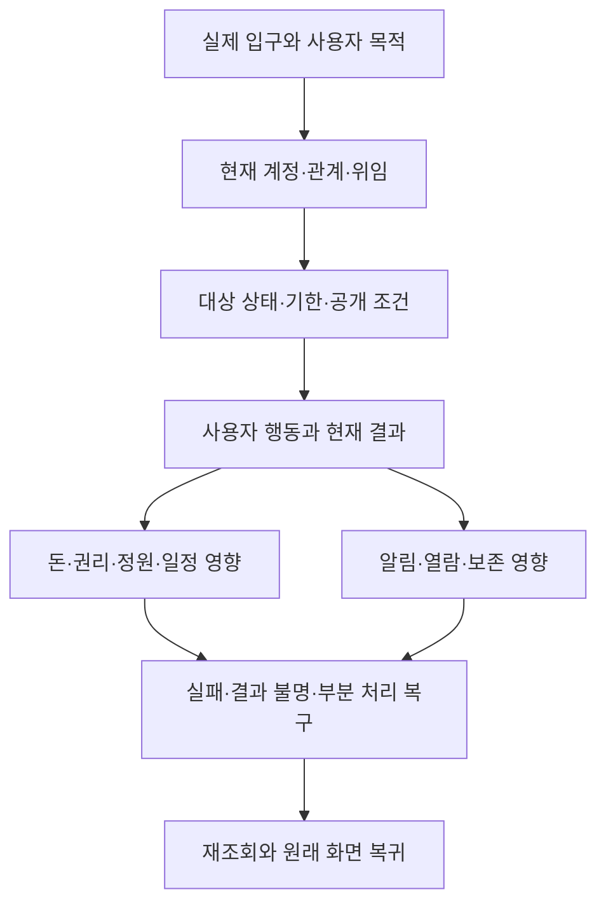

# 21개 업무 영역의 서비스 지도

<!-- release-document: reference -->
> 2026-11-22 현재 기능·정책 정본을 대조한 기획용 안내다. 문서 대조와 제품 실행·외부 연동·공개 확인은 구분한다. 실행 순서는 [앞으로 할 일](../../docs/plan/NEXT_WORK.md)을 따른다.

## 전체 제품 구조

전체 21개 영역·175개 기능을 다룬다. 이 지도는 문서를 찾아가는 책임 지도이며 서버 호출도·화면 메뉴 배치도·공개 기능 목록이 아니다. 상세 범위와 예외는 연결된 영역 정본을 따른다.

| 영역 정본 | 맡는 책임 |
|---|---|
| [인증 & 온보딩](../prd/01_domain_prds/01_인증_and_온보딩_prd.md) | 가입·접근 복구·세션과 첫 이용 설정 |
| [홈 피드](../prd/01_domain_prds/02_홈_피드_prd.md) | 공개·개인화 콘텐츠와 상세로 가는 입구 |
| [이벤트](../prd/01_domain_prds/03_이벤트_prd.md) | 모임 작성·발견·신청·참석과 운영 |
| [클럽](../prd/01_domain_prds/04_클럽_prd.md) | 회원 관계·커뮤니티·공동 활동과 재정 |
| [검색](../prd/01_domain_prds/05_검색_prd.md) | 질문·필터로 공개 대상을 찾고 재사용 |
| [결제 & 지갑](../prd/01_domain_prds/06_결제_and_지갑_prd.md) | 유료·무료 포인트, 결제·환불·수익 |
| [모임 정산](../prd/01_domain_prds/07_모임_정산_prd.md) | 지출·수입을 반영한 분담과 반환 |
| [플랜 마켓](../prd/01_domain_prds/08_플랜_마켓_prd.md) | 작성물·상품·구매 권리·환불 |
| [프라이빗 데이팅](../prd/01_domain_prds/09_프라이빗_데이팅_prd.md) | 본인확인·후보·매칭·대화·안전 |
| [캘린더](../prd/01_domain_prds/10_캘린더_prd.md) | 내 일정·공개 모임과 본인 가능 시간 |
| [리뷰 & 신고](../prd/01_domain_prds/11_리뷰_and_신고_prd.md) | 후기·선택 피드백·신고·신뢰·취향 |
| [알림](../prd/01_domain_prds/12_알림_prd.md) | 사건의 기록·전달·읽음·수신 설정 |
| [프로필 & 설정](../prd/01_domain_prds/13_프로필_and_설정_prd.md) | 본인 정보·내보내기·계정 종료 |
| [위치 & 길찾기](../prd/01_domain_prds/14_위치_and_길찾기_prd.md) | 위치 동의·좌표·열람·외부 지도 |
| [경고 & 징계](../prd/01_domain_prds/15_경고_징계_prd.md) | 신고 심사·경고·제재·이의 |
| [마일리지](../prd/01_domain_prds/16_마일리지_prd.md) | 클럽 활동 점수·제도·시즌·검토 |
| [정기모임](../prd/01_domain_prds/17_정기모임_prd.md) | 고정·가변 회차와 등록·출석·코스 정산 |
| [분쟁 해결](../prd/01_domain_prds/18_분쟁_해결_prd.md) | 원천별 사건·접수·이의·대화·증거 |
| [관심인](../prd/01_domain_prds/19_관심인_prd.md) | 단방향 관심 목록·공개 모임·노출 설정 |
| [고객지원](../prd/01_domain_prds/20_고객지원_prd.md) | 일반 문의·거래 운영 이슈·도움말 |
| [제공자 배정·정산](../prd/01_domain_prds/21_제공자_배정_정산_prd.md) | 서비스 배정·조건·분담·정산·회수 |

## 연결을 검토하는 순서

화살표는 기획 검토 순서다. 모든 기능이 돈을 움직이거나 모든 알림이 실제 도착한다는 실행 계약은 아니다.

## 연결별로 구분할 것

| 연결 | 확인할 경계 |
|---|---|
| 발견과 접근 | 홈·검색·관심인에 보이는 것과 직접 상세를 열 권한은 다름 |
| 신청·승인·결제·참석 | 정원·대기열·납부·은행 확인이 남을 수 있음 |
| 클럽·정기모임·이벤트 | 클럽 회원 관계, 코스 등록, 회차 참석은 별도 기록 |
| 지갑·직접 송금·모임 정산 | 플랫폼 잔액과 당사자 은행 수취, 실제 수취자별 반환 책임을 구분 |
| 마일리지·스탬프·무료 포인트 | 활동 점수·참여 기록·지갑 통화를 서로 바꾸어 설명하지 않음 |
| 후기·신고·경고·분쟁 | 접수·판정·제재·이의·보상과 공개 범위가 각각 다름 |
| 일정·위치 | 본인 가능 시간, 공개 모임 표시, 좌표 동의·조회·열람 기록은 별개 |
| 판매·제공자 거래 | 판매 승인·구매 권리·계약 이행·정산 확정·실제 지급을 분리 |
| 알림과 지원 | 발송 의도·알림함·기기 수신, 문의 종결·원래 업무 해결을 구분 |

영역별 작업 질문은 [업무 영역 검토 안내](03_unit_playbooks.md), 상태·권한·검증은 [상태 가이드](04_state_policy_guide.md), [역할 가이드](09_actor_permission_matrix.md), [기획 QA](10_planning_qa_checklist.md)에서 이어서 확인한다.
