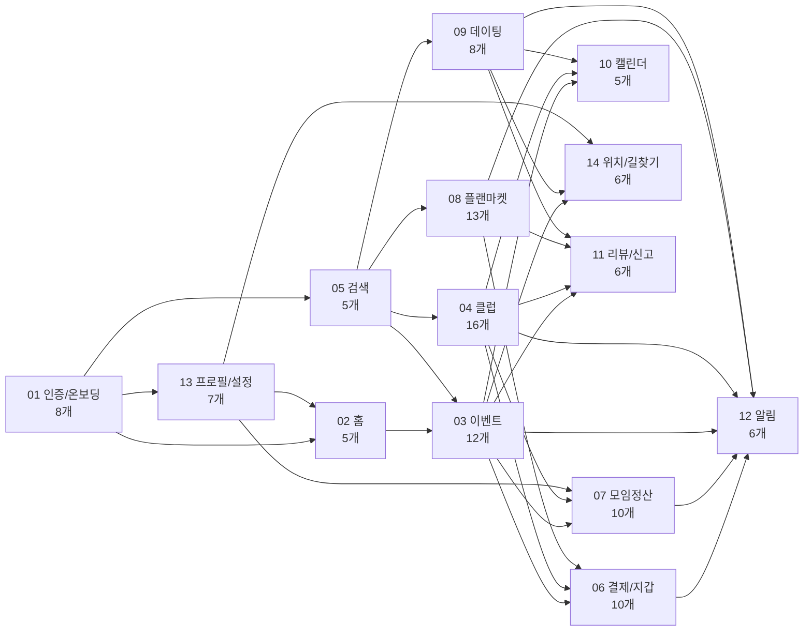

# Unit-backed 기능 인벤토리

<!-- release-document: reference -->
> **문서 구분: 기능·설계·절차 참고 문서.** 본문의 요구사항·과거 확인은 현재 미구현 목록이 아닙니다. 현재 작업 순서는 [앞으로 할 일](../../docs/plan/NEXT_WORK.md)을 따릅니다.

이 문서는 전체 21개 도메인·175개 기능 중 `business_logic/units/` 근거가 있는 14개 도메인·117개 기능을 모두 펼쳐 놓은 하위 집합 검산표다. 이 표에 없는 추가 7개 도메인과 F03·F04·F08·F11의 신규 기능을 포함한 총 58개 no-unit 기능은 실제 소스를 canonical로 삼는 source-first 계열이므로, 전체 누락 검산에는 [175개 기능 정의](../prd/00_prd_items/05_feature_definitions.md)를 함께 사용한다. 각 기능의 세부 정책은 별도 기능 카드로 확장한다.

## Unit-backed 커버리지 요약

| 영역 | 기능 수 | 원문 시나리오 수 | 원문 도식 수 |
|---|---:|---:|---:|
| 01 인증 & 온보딩 | 8 | 82 | 34 |
| 02 홈 피드 | 5 | 38 | 21 |
| 03 이벤트 | 12 | 115 | 55 |
| 04 클럽 | 16 | 191 | 62 |
| 05 검색 | 5 | 41 | 20 |
| 06 결제 & 지갑 | 10 | 71 | 45 |
| 07 모임 정산 | 10 | 84 | 53 |
| 08 플랜 마켓 | 13 | 125 | 58 |
| 09 프라이빗 데이팅 | 8 | 70 | 32 |
| 10 캘린더 | 5 | 40 | 26 |
| 11 리뷰 & 신고 | 6 | 39 | 27 |
| 12 알림 | 6 | 38 | 25 |
| 13 프로필 & 설정 | 7 | 35 | 26 |
| 14 위치 & 길찾기 | 6 | 42 | 24 |
| unit-backed 하위 집합 합계 | 117 | 1011 | 508 |

## Unit-backed 기능 흐름

## 01. 인증 & 온보딩

| ID | 기능 | 주 사용자 | 기획 검산 포인트 |
|---|---|---|---|
| F01-01 | 이메일 회원가입 & 로그인 | 신규/기존 사용자 | 가입 전 번호 확인·정보 검증과 가입 응답 뒤 내 정보 조회·세션 설치를 구분한다. 상태별 로그인과 응답 유실 복구를 확인한다. |
| F01-02 | 소셜 로그인 | 신규/기존 사용자 | 기존 Google 로그인·신규 가입·기존 이메일 연결과 각 단계의 취소·확인표 소비·늦은 결과를 구분한다. |
| F01-03 | 이메일 인증 | 신규 사용자 | 가입 전 번호 확인·재발송 제한·만료·오입력·발송과 실제 수신 구분 |
| F01-04 | 비밀번호 재설정 | 비로그인 사용자 | 계정별 메일 차이·확인표 만료/소비·비밀번호 규칙·세션과 AI 연결 해지 |
| F01-05 | 토큰 갱신 & 로그아웃 | 로그인 사용자 | 동시 갱신·응답 유실·일시 오류의 세션 유지와 명시적 거절을 구분하고, 로그아웃은 해당 세션·푸시만 정리한다. |
| F01-06 | 온보딩 | 첫 로그인 사용자 | 네 단계의 저장·건너뛰기·재개를 구분한다. 서버 완료 요청 실패를 앱이 확인하지 않는 차이와 단계별 부분 저장을 남겼다. |
| F01-07 | 관심사 태그 관리 | 로그인 사용자 | 카탈로그 태그의 본인 소유·20개 상한·단건 저장을 확인한다. 온보딩의 부분 저장과 프로필 쓰기 실패 안내, 화면 명세와의 차이는 남아 있다. |
| F01-08 | 소셜 계정 연결 해제 | 로그인 사용자 | 실제 연결과 활성 제공자를 구분하고, 마지막 수단·동시 해제·결과 유실을 확인한다. 비활성 수단 계산의 조건부 차이를 남겼다. |

## 02. 홈 피드

| ID | 기능 | 주 사용자 | 기획 검산 포인트 |
|---|---|---|---|
| F02-01 | 홈 피드 메인 조회 | 비로그인·로그인 사용자 | 핵심 네 결과와 회원별 보조 구역, 공개·위치·부분 실패·마켓 숨김을 구분한다. |
| F02-02 | 홈 피드 새로고침 | 비로그인·로그인 사용자 | 강제 갱신·5분 캐시·세대 변경·부분 실패와 별도 보조 공급자의 갱신 범위를 구분한다. |
| F02-03 | 홈 카드와 더보기의 이동·복귀 | 비로그인·로그인 사용자; 목적지 권한 적용 | 구역별 카드와 더보기 목적지, 추천 상세 중간 단계·보조 추천·출발 경로별 복귀를 구분한다. |
| F02-04 | 추천 이벤트 더보기·필터·더 읽기 | 로그인 사용자 | 추천 후보와 점수, 페이지별 필터·정렬·빈 첫 페이지·기간 이름·추천 이유의 차이를 명시한다. |
| F02-05 | 홈의 검색·알림 진입점 | 비로그인·로그인 사용자 | 공통 상단의 세 행동·검색 공개·알림 로그인·미읽음 실패·전체 메뉴 점·복귀와 갱신을 구분한다. |

## 03. 이벤트

| ID | 기능 | 주 사용자 | 기획 검산 포인트 |
|---|---|---|---|
| F03-01 | 이벤트 발견과 탐색 | 모임을 찾는 사용자 | 공개 후보·차단·날짜순/인기순·필터 초안·페이지 재시도·호스트별 입구·유사 조회의 실패/빈 결과를 구분한다. |
| F03-02 | 이벤트 상세 조회 | 참가자·호스트·공동호스트 | 일시·장소·정원·참가 상태·비용 안내가 서버의 현재 상태와 일치하고 가능한 행동만 열린다. 차단·클럽 탈퇴·취소·일정 변경 뒤 이전 상세가 남지 않으며 게시글/참가자 투표는 각 권한을 따른다. 설명 첨부 사진의 순서와 열람 제한도 함께 확인한다. |
| F03-03 | 이벤트 생성과 다음 일정·반복 일정 | 개인 호스트·클럽 생성 권한자 | 기기 저장·서버 초안·공개, 미확정 요청 복원, 다음 일정 복제, 반복 자식 초안과 공동호스트 권한을 구분한다. |
| F03-04 | 이벤트 수정·공개·종료·취소 | 호스트·공동호스트 | 상태별 수정 입구·편집 복원, 취소 확정과 비동기 환불, 공지 대상·한도, 반복 회차 결과·위치 공유 허용을 구분한다. |
| F03-05 | 이벤트 신청·참석·본인 취소 | 참가자 | 직접 참석·심사·결제 대기와 일행 배치, 재신청·일정 변경 동의·본인 취소의 결과를 구분한다. |
| F03-06 | 신청서 승인·거절과 일괄 처리 | 호스트·공동호스트 | 호스트의 심사 권한·무료 배치·유료 결제 대기·사유 기록과 단건·일괄 실패 후 재시도를 구분한다. |
| F03-07 | 정원 설정·대기열·모집 관리 | 정원·출석 관리자와 참가자 | 정원과 예약 좌석·업무별 권한·대기 정보 공개·승격 조건·제거와 모집 변경의 현재 결과를 구분한다. |
| F03-08 | QR·코드·직접 체크인 | 출석 관리자·참석자 | QR·6자리 코드와 게스트 체크인, 직접 체크인의 시간·행별 처리·부분 완료, 통계의 현재 차이를 구분한다. |
| F03-09 | 이벤트 사진첩 | 사진 운영자·실제 참석자 | 파일 번호 기반 등록·실패 사진 재시도·사진 공개와 신고 보존·앨범의 네 상태·부분 정리와 현재 앱 차이를 구분한다. |
| F03-10 | 이벤트와 플랜 연결 | 플랜 연결 관리자 | 플랜 사용 권리·전체 연결 순서·개별 장소와 시각·관리와 상세의 노출 차이·응답 불확실성을 구분한다. |
| F03-11 | 찜한 이벤트 | 로그인 회원 | 찜 추가·해제 조건과 현재 열람 가능한 목록, 즉시 반영·응답 유실·연속 조작을 구분한다. |
| F03-12 | 내 이벤트와 참석 변경 기록 | 회원·호스트·참석 관리자 | 신청·주최·지난 주최·참석 이력의 범위와 참석 변경 기록의 권한·표시·페이지 실패를 구분한다. |
| F03-13 | 이벤트 참가비 선입금·은행 확인·환불 기록 | 참가자·호스트·공동호스트·환불 담당 | 참가비 수단·은행 신고/확인 큐, 정확한 결제 번호·요청 재생, 반환 의무·증빙·수령 확인·알림과 한계를 대조했다. |
| F03-14 | 이동수단 공통 설정 | 호스트·공동호스트 | 현재 이동 조율 정책·실제 참석 조회 권한·배정 보존·구형 쓰기 종료·같은 요청 복구와 개정 충돌을 구분한다. |
| F03-15 | 카풀 지원·개별 이동 | 차량 지원자·주최자·탑승자 | 지원과 배정 분리·운전자 제외 동승 정원·개별 이동·운행 취소와 전원 교체·개인 승차 장소·차량 신고를 현재 흐름으로 정리한다. |
| F03-16 | 대절 버스와 자리 배정 | 주최자·탑승자 | 버스 등록·첫 직접 잡기/배정 후 변경/비우기 권한·차량과 물리 좌석 분리·도면 전환·전체 변경 보존을 구분한다. |
| F03-17 | 차량 좌석 배치도 운영 | 차량 배치도 운영자 | 좌석표 편집·실물 확인 기록·별도 활성화·사용 후 원본 보호·복제/삭제와 합성 자료/제조사 후보/공개 도면을 구분한다. |
| F03-18 | 이벤트 구성 통계 | 모임 열람 권한자 | 모임 상세와 통계 권한·실제 참석 회원 집계·차원별 최소 기준·응답 수치와 화면 표시를 구분한다. |
| F03-19 | 일정 변경 제안·참가자 합의 (RS-002) | 호스트·공동호스트·참가자 | 일정 변경 분류·동의·확정·철회·기한 경과 저장·취소 실패 재시도·재전송과 실제 앱 입구·갱신을 구분한다. |
| F03-20 | 이벤트 노쇼 관리 | 호스트·출석/환불 권한자·참가자 | 노쇼 확정·본인/게스트 직접 소명·거절/번복·실제 미참석 환불 자격·원결제별 잔여 배정·0원 기록·알림과 조회를 구분한다. |

## 04. 클럽

| ID | 기능 | 주 사용자 | 기획 검산 포인트 |
|---|---|---|---|
| F04-01 | 클럽 찾기와 모임 탭 탐색 | 비로그인·로그인 사용자 | 모임 탭의 실제 입구, ACTIVE 검색·역할/가입 상태, 제출형 검색·카테고리, 페이지 실패와 인기 구역 재시도를 구분한다. |
| F04-02 | 클럽 상세와 가입·탈퇴 | 비로그인·비회원·현재 회원 | 공개 상세·회원 홈/정보, 선택 가입 메시지·승인 시 가입비, 동일 명령·탈퇴 후 참가/환불·현재 상세 복구를 구분한다. |
| F04-03 | 클럽 생성·수정·폐쇄와 소유권 이전 | 생성자·권한 있는 운영진·소유자·인수 회원 | 입력 복구·정원·권한 재확인, 폐쇄 금액 동의와 후속 반환, 재인증·책임 확인을 거친 소유권 이전과 실제 최종 결과를 구분한다. |
| F04-04 | 회원 목록·역할·권한 위임과 강퇴 | 현재 회원·유효 운영진·소유자 | 검색·행 행동 권한·강등 회수·위임 가능 비트·강퇴 사유/동일 명령·참가/반환과 기록을 구분한다. |
| F04-05 | 가입 신청 처리·초대 발송과 받은 초대 | 신청자·현재 운영진·초대 수신자 | 신청 승인/거절·후보 권한·초대 발송/취소·받은 이력·가입비 재확인·최종 상태/복귀·만료 보존을 구분한다. |
| F04-06 | 클럽 차단·기간·해제 관리 | 유효 운영진·소유자·차단 대상 | 명령 키·사유/증빙·회원/비회원 차단·대기 종료 이력·기간과 만료 정리·사유 원천·해제 후 재가입을 구분한다. |
| F04-07 | 내 클럽 목록과 회원 활동 통계 | 현재 회원·유효 운영진 | 기본ACTIVE 내클럽·소유자 구역·20개 페이지 복구·현재회원 체크인 집계·최근 한 달·TOP5와 제공하지 않는 통계를 구분한다. |
| F04-08 | 게시판·게시글·예약·초안과 작성 글 모아 보기 | 현재 회원·글 작성자·유효 운영진·프로필 조회자 | 게시판관리제공범위·글권한/상태·검색미적용·사진·초안/멱등재확인·예약실제결과·좋아요·프로필작성글범위를 구분한다. |
| F04-09 | 게시글 댓글·답글·멘션과 대상 댓글 찾기 | 현재 회원·댓글 작성자·유효 운영진 | 실제 정렬·50개 부모 페이지·차단/삭제 가림·입력 보존·멘션·운영진 사유 삭제·알림 대상 찾기의 결과를 구분한다. |
| F04-10 | 공지 읽기·작성·수정과 예약 게시 | 현재 회원·유효 운영진·예약 작성자 | 실제읽기/행동입구·작성/수정/삭제권한·본문/사진·고정한도·예약최종결과·초안/불명확전송·알림확산을 구분한다. |
| F04-11 | 클럽 사진첩·등록 복구·공개 범위·댓글 | 현재 회원·앨범 작성자·사진 업로더·유효 운영진·허용된 로그인 비회원 | 앨범/사진 권한·회원/공개 열람·기기 초안과 같은키 등록·대표 사진/파일 정리·댓글 상태/언급/페이지/알림 착지를 구분한다. |
| F04-12 | 클럽 모임·캘린더·통계·반복 초안 | 현재 회원·유효 운영진·참석자 | 실제 상세 입구·무료 자동 참가 조건·공통 신청/결제·월/주 달력·통계 산식·반복 초안과 재전송을 구분한다. |
| F04-13 | 클럽 기금 잔액·월별 기부 차트·거래 내역 | 현재 회원·정본 클럽장 | 잔액·기부 월별 집계·원장 거래와 출금 가용액을 구분하고, 넘기기 상세의 미납금 상환·버전·통화 조건을 확인한다. |
| F04-14 | 클럽 기부·내역·취소·폐쇄 반환 | 현재 회원·기부자·정본 클럽장·환불 운영자 | 1,000~1,000,000·메시지·통화·요청 키, 전체/본인 내역과 전체 요약, 7일 취소·알림·폐쇄 반환을 구분한다. |
| F04-15 | 클럽 기금 출금 신청·예약·지급 상태 | 정본 클럽장·출금 운영자 | 신청 가용액·월 제한·등록 계좌·공제 계산, 승인 시 총액 예약과 실제 지급 상태, 반려 복원·새 클럽장 계좌 비공개를 구분한다. |
| F04-16 | 클럽 운영 구독·갱신·해지·정지·환불 | 클럽장·본인 구독 보유자·운영자 | 실제 운영 구독 입구·인증/본인 조회·기금과 지갑·기간 연장·갱신/해지/정지 사유·세 가지 운영자 환불과 결과 갱신을 구분한다. |

## 05. 검색

| ID | 기능 | 주 사용자 | 기획 검산 포인트 |
|---|---|---|---|
| F05-01 | 키워드 검색 | 검색 사용자; 사람 검색은 로그인 필요 | 실제 검색 입구·유형별 공개 조건·건수·정렬·더 읽기와 복귀를 구분한다. |
| F05-02 | 자동완성과 인기 모임 제목 제안 | 검색 사용자 | 자동완성의 두 대기 구간·후보·늦은 응답과 인기 모임 제목 태그를 구분한다. |
| F05-03 | 이벤트 검색 필터 | 검색 사용자 | 이벤트 전용 조건·임시 편집·건수 실패·좌표 누락·추천 힌트의 차이를 명시한다. |
| F05-04 | 최근 검색어 | 로그인 사용자 | 서버 기록 없이 계정별 기기 20개 저장·삭제·로그아웃 유지·탈퇴 정리를 구분한다. |
| F05-05 | 저장된 검색과 새 결과 알림 | 로그인 사용자 | 서버 10개 저장·조건 수정·실행 기록과 결과 조회 분리·알림 집계 차이를 명시한다. |

## 06. 결제 & 지갑

| ID | 기능 | 주 사용자 | 기획 검산 포인트 |
|---|---|---|---|
| F06-01 | 지갑 메인 조회 | 로그인 사용자 | 지갑·최근 세 거래의 별도 조회, 만료 무료 잔액 보정, 입구와 갱신·숨김 경계를 구분한다. |
| F06-02 | 포인트 충전 | 지갑을 충전하는 회원 | 주문·결제창·적립을 구분하고 확인 중 결과의 재충전 차단, 카드 선택과 실제 결제의 차이, 취소·복귀를 설명한다. |
| F06-03 | 거래 내역·상세·내보내기 | 로그인 사용자; 본인 거래 | 본인 거래의 페이지·필터, 상세 증감·취소 누계와 CSV의 별도 범위·날짜 경계를 명시한다. |
| F06-04 | 결제수단 관리 | 카드를 등록·관리하는 회원 | 서버 등록 세션과 결제사 인증, 5개 한도, 기본 지정·삭제·무효 카드와 자동충전 연결을 구분한다. |
| F06-05 | 자동충전 설정과 실행 | 자동충전을 설정한 회원 | 설정 저장과 실제 부족액 기준 실행, 카드·월 한도·확인 중 결과, 원 구매 재시도와 해제의 한계를 구분한다. |
| F06-06 | 참가비 지갑 결제·신청 취소·환불 | 참가비를 결제·취소하는 회원 | 신청별 참가비 결제와 취소, 서버 예상액·일행 추가분·지갑 반환과 계좌이체 반환 대기, 정산 영향을 구분한다. |
| F06-07 | 이벤트 개설권 구매·사용·반환 | 개설권을 구매·사용하는 회원 | 유료 잔액 구매·응답 유실 재시도·유효 목록, 실제 소비 원본의 반환과 남은 장 운영자 환불을 구분한다. |
| F06-08 | 개인 멤버십 구독·갱신·해제 | 개인 멤버십을 이용하는 회원 | 서버 가입 판정과 기간 구간, 지갑 차감·자동갱신·정지·해제, 가격 동의와 혜택 조회의 한계를 설명한다. |
| F06-09 | 수익 대시보드 조회 | 로그인 사용자; 본인 호스트 정산 | 지급 완료 수익과 상태 무관 최근 정산, 월별 12개월·정기모임 표시·갱신 한계를 구분한다. |
| F06-10 | 호스트 정산 내역·이의 제기 | 본인 정산을 가진 호스트 | 목록·요약 범위, 거절 정산 이의 접수와 운영자 승인 재개, 실패 사유 보존·지급 근거 복구를 구분한다. |

## 07. 모임 정산

| ID | 기능 | 주 사용자 | 기획 검산 포인트 |
|---|---|---|---|
| F07-01 | 정산 초안·첫 비용 저장·복사·계산 결과 가져오기 | 현재 주최자·정산 생성자 | 초안과 첫 비용 저장을 구분하고 부분 실패·응답 유실·취소 교체·복사 소유권·참가자 연결·계산 결과 추가/교체를 확인한다. |
| F07-02 | 정산 항목·배분 편집·영수증·최근 항목 | 정산 생성자·현재 주최자(조회) | 서버 목록·행동 권한·저장 배분 복원·세 가지 분할과 미리보기·영수증 연결·최근 항목·저장 실패와 계정 경계를 구분한다. |
| F07-03 | 금액 검토·정산 요청·취소와 반환 | 정산 생성자·현재 주최자·납부/수취 당사자 | 검토 후 요청·실제 납부자 알림·바로 완료·정산 번호와 권한·취소와 반환 분리·외부/포인트/가상계좌·응답 불확실·복구와 초안 정리를 구분한다. |
| F07-04 | 정산 현황·금액 요약·영수증 열람 | 정산 생성자·현재 주최자·허용 참석자·분담/송금 당사자 | 현재 정산과 원본 이력·초안 차등 공개·지출/수입/차액/실제 납부·인원 진행률·방식별 다음 행동·영수증 권한·부분 실패와 복귀를 구분한다. |
| F07-05 | 항목별 분담·송금 납부·송금 신고·포인트 반환 | 실제 납부자·수취자·정산 생성자 | 항목별 납부와 직접 송금 차액·포인트/혼합·계좌 조회·보냈어요·실제 수취 확인·취소 뒤 반환·명령 중복과 계정 경계를 구분한다. |
| F07-06 | 수취 확인·일괄 확인·만료·재요청·손실 정리 | 실제 수취자·정산 생성자·허용 운영자 | 수취 확인과 신고·일괄 건별 처리·만료의 미완료 의무·재요청/포기·운영자 은행분 해소·전체 완료를 구분한다. |
| F07-07 | 다시 알림·마감 연장·알림 기록 | 정산 생성자·실제 지급자·허용 관리자 | 실제 지급자·송금 신고·수신자별24시간·마감 기준 시각·자동 처리 주기·입력/이력 표시와 요청/수신의 차이를 구분한다. |
| F07-08 | 정산 이의제기·처리·변경 기록 | 정산 당사자·정산 생성자·운영팀 | 이의 대상·참석 자격·입력/재시도·생성자와 운영팀 처리·조회 권한·기록 공개와 보관 범위를 구분한다. |
| F07-09 | 출시 제한 중인 정산 선입금·환불 규정 | 제품 담당자·개발자·운영자 | 참가비 선입금과 분리하여 서버 여덟 창구·앱 경로 제한, 보존 계약·내부 의무·상품 재개 조건을 설명한다. |
| F07-10 | 정산 계좌·내 정산·호스트 평판 | 회원·정산 작성자 | 계좌 소액 확인의 한계, 개인 합계·기간·원본 이동, 모임별 목록과 평판 공개 조건을 구분한다. |

## 08. 플랜 마켓

| ID | 기능 | 주 사용자 | 기획 검산 포인트 |
|---|---|---|---|
| F08-01 | 내 플랜 목록과 새 플랜 생성 | 플랜 작성자·회원 | 계정별 만든·구매 목록, 새 초안 입력·한도와 기기 기록에 의한 결과 불명 복구를 설명한다. |
| F08-02 | 플랜 상세·미리보기와 관리 행동 | 플랜 작성자·회원 | 기본 정보·전체 본문·견본의 권한, 무료 읽기와 구매 구분, 삭제·복제·판매 중지의 결과와 복구를 설명한다. |
| F08-03 | 플랜 블록 편집·저장·복구 | 플랜 작성자 | 본인 DRAFT의 블록 편집, 기기 보관과 서버 저장, 충돌 보류·재시작 복구, paste와 순차 틀 추가, 표·TODO·미디어 계약을 현재 구현에 맞춘다. |
| F08-04 | 블록 순서와 계층 변경 | 초안 작성자 | 편집기 메뉴에서 순서·계층을 바꾸고 최신 트리에 이동 의도를 재적용한다. 범위별 저장, 개정 번호 보호와 부분 반영 복구를 구분한다. |
| F08-05 | 플랜 공개와 예약 공개 | 플랜 작성자 | 준비도 9개 항목, 입력 복원·선저장, 플랜 공개와 상품 READY의 구분, 예약 생성·실행·실패 알림·복구를 설명한다. |
| F08-06 | 내 상품 등록·심사·판매 관리 | 회원 판매자·운영자 | 실제 관리 입구에서 콘텐츠를 연결하고 후보 버전을 심사받는다. 변경 필드 저장·재심사·판매 상태·설명 사진·예약·플랫폼 기간권의 경계를 구분한다. |
| F08-07 | 크리에이터 프로필·판매 현황 | 로그인 회원·크리에이터 | 크리에이터 프로필과 본인 판매 현황의 입구·공개 조건을 구분하고, 플랜 구매·수익 귀속·전환·조회 집계의 실제 범위와 조회 실패를 설명한다. |
| F08-08 | 마켓 메인 탐색 | 로그인 탐색 회원 | 홈의 플랜 더보기에서 판매 중 상품을 탐색한다. 유형·분류·정렬·가격은 본문 목록에 적용하고 인기10개·최근본목록·조회실패·기간권 공개 조건을 구분한다. |
| F08-09 | 마켓 키워드 검색 | 로그인 탐색 회원 | 검색어를 안전하게 전달하고 제목·설명의 부분 일치 결과를 20개씩 읽는다. 서버 전체 건수·첫조회 오류·추가조회 오류·재검색·기간권 제한을 구분한다. |
| F08-10 | 마켓 상품 상세·구매 입구 | 탐색자·구매자·상품 소유자 | itemId 상세의 익명 열람·소유/구매 접근과 인증이 필요한 후기·번들을 구분한다. 설명 사진·판매/결제/로그인별 구매 입구·후기 권한·조회수와 실패 복구를 현재 소스로 설명한다. |
| F08-11 | 상품·번들·플랜 구매 | 구매 회원 | 상품·번들의 영수증 재시도와 플랜 직접 구매의 중복 차단을 구분한다. 승인 버전 가격·구매 한도·재고·소유자 수익·권리 부여·실패 후 복구를 실제 호출에 맞춘다. |
| F08-12 | 내 보관함 | 구매 회원 | 보관함 입구·세 필터·켜기 권한·상품별 전달·만료 갱신·환불 연결과 결과 화면 복귀를 구분한다. 활성화 재요청과 전달 키, 목록 재조회 중 행 잠금의 현재 계약을 반영한다. |
| F08-13 | 구매 플랜으로 모임 만들기·후기 작성 | 구매 회원·호스트 | 플랜 권리·호스트 조건으로 모임 초안을 만들고 저장한 키·본문으로 결과를 복구한다. 상품 후기의 구매 자격·삭제 후 재작성·수정/삭제 권한·상세 갱신 차이를 명시한다. |

## 09. 프라이빗 데이팅

| ID | 기능 | 주 사용자 | 기획 검산 포인트 |
|---|---|---|---|
| F09-01 | 본인 인증 | 데이팅 사용자 | 인증 요청/검증, 미성년/실패, 재인증 |
| F09-02 | 데이팅 프로필 관리 | 데이팅 사용자 | 사진, 소개, active 토글, 미인증 차단 |
| F09-03 | 후보자 스와이프 & 매칭 액션 | 데이팅 사용자 | LIKE/PASS, 상호 매칭, 일일 한도 |
| F09-04 | 매칭 목록 조회 | 데이팅 사용자 | 새매칭/대화중, 차단/만료 상태 |
| F09-05 | 채팅 | 매칭 사용자 | 메시지, 읽음, 중복 전송, 차단 |
| F09-06 | 만남 제안 & 안전 흐름 | 매칭 사용자 | 제안/수락/거절, 일정/장소, 안전 기능 |
| F09-07 | 사용자 차단/해제 | 데이팅 사용자 | 후보/매칭/채팅 어디서든 차단, cascade |
| F09-08 | 내 프로필 조회 이력 | 데이팅 사용자 | 조회자 목록, 차단/비활성 사용자 필터 |

## 10. 캘린더

| ID | 기능 | 주 사용자 | 기획 검산 포인트 |
|---|---|---|---|
| F10-01 | 월간·일간 통합 달력 | 회원 | 월·일·기간 조회의 집계 범위, 서울 날짜 이동, 관심인 모임과 본인 가능 시간, 변경 신호·오류 재조회를 구분한다. |
| F10-02 | 달력 항목과 상세 연결 | 회원 | 월 카드·일간 블록의 같은 이동 조건, 잘못된 식별자, 비이동 항목, 편집 후 갱신과 복귀를 연결한다. |
| F10-03 | 본인 가능 시간 등록·수정·삭제 | 회원 | 본인 전용 가능 시간의 서울 시각·30분 단위·겹침·제목·삭제 확인과 실제 저장 후 달력 갱신을 정리한다. |
| F10-04 | 반복 가능 시간 규칙 관리 | 회원 | 매주·격주·매월 규칙의 본인 목록·편집·실제 인스턴스와 예상 개수·전체 삭제·무기한 연장 조건을 구분한다. |
| F10-05 | 타 사용자 가능 시간 공개 기능 폐기와 비공개 경계 | 회원·운영자 | 폐기된 공개·친구 가능 시간 조회를 복구 대상으로 두지 않는다. 본인 전용 모델·요청·권한과 관심인 공개 모임의 차이를 확인한다. |

## 11. 리뷰 & 신고

| ID | 기능 | 주 사용자 | 기획 검산 포인트 |
|---|---|---|---|
| F11-01 | 이벤트 후기 작성과 선택형 피드백 | 참석 회원 | 별점 후기와 사람 선택 피드백의 서로 다른 기간·자격·초안·중복 키·태그·본인 기록을 구분한다. |
| F11-02 | 이벤트 후기와 사용자가 받은 후기 조회 | 회원 | 받은 후기와 작성한 후기를 구분하고 차단·프로필 접근·숨김 마스킹·역할별 메뉴·갱신을 현재 계약에 맞춘다. |
| F11-03 | 후기 수정과 삭제 | 후기 작성자 | 작성자 5회 수정·삭제 후 재작성 금지·입력 보존·응답 불확실성과 관련 목록 갱신을 구분한다. |
| F11-04 | 신고 접수·관할 결정·본인 처리 내역 | 회원 | 대상15종·전용 접수·관할과 맥락 검사·중복/우선 검토·본인 신고 상세와 문의 연결을 갱신한다. |
| F11-05 | 신뢰점수 계산과 본인 변동 이력 | 회원 | 현재 조회와 저장 이력·정확한 점수식·신고 감점 범위·본인 접근·동의 경계를 현재화한다. |
| F11-06 | 본인 취향 프로필과 선언 선호 관리 | 회원 | 선호 전체 해제·저장 실패 유지·본인 선택 누적과 행동 근사·내보내기·태그 표시 한계를 현재화한다. |

## 12. 알림

| ID | 기능 | 주 사용자 | 기획 검산 포인트 |
|---|---|---|---|
| F12-01 | 알림 목록 조회 & 읽음 관리 | 로그인 사용자 | 딥링크, 모두 읽음, 삭제, 무한스크롤 |
| F12-02 | 알림 그룹 보기 & 미읽음 배지 | 로그인 사용자 | 그룹 토글, 배지 감소, 빈 인박스 |
| F12-03 | 카테고리별 알림 설정 | 로그인 사용자 | 카테고리와 내부 타입 매핑, 실패 원복 |
| F12-04 | 방해금지 시간 설정 | 로그인 사용자 | 자정 넘김, 요일, 카테고리 설정과 중첩 |
| F12-05 | FCM 디바이스 토큰 등록 & 기기 관리 | 로그인 사용자 | 다중 기기, 토큰 갱신, 로그아웃 해제 |
| F12-06 | 알림 권한 인라인 안내 배너 | 로그인 사용자 | OS 권한, 설정 진입, lifecycle 재확인 |

## 13. 프로필 & 설정

| ID | 기능 | 주 사용자 | 기획 검산 포인트 |
|---|---|---|---|
| F13-01 | 마이페이지와 프로필 탐색 | 로그인 사용자 | 허브·상세의 메뉴, 성향·만난 사람, 받은 후기·작성 글·계정별 복귀를 구분한다. |
| F13-02 | 프로필 편집과 사진 변경 | 로그인 사용자 | 닉네임·소개·MBTI·사진의 저장·이탈과 계정 전환을 구분한다. |
| F13-03 | 주소 추가·수정·기본 주소 관리 | 로그인 사용자 | 10개 상한·주소 좌표·기본 지정·이름표 잔존·실패 안내 차이를 구분한다. |
| F13-04 | 선호 태그 관리 | 로그인 사용자 | 내 프로필의 단건 추가·삭제·20개 상한·조회 오류와 쓰기 실패 안내 누락을 구분한다. 공통 저장·추천 규칙은 관심사 PRD를 따른다. |
| F13-05 | 데이터 내보내기 | 로그인 사용자 | 처리중/완료/실패/만료, 다운로드 |
| F13-06 | 계정 삭제 요청과 취소 | 로그인 사용자 | 사전 의무·보관금 동의, 예약·취소·제재 중 지연과 부분 정리·외부 완료를 구분한다. |
| F13-07 | 계정 즉시 탈퇴 | 로그인 사용자 | 사전 점검·조건부 동의·잠금 뒤 재판정, 부분 정리·응답 유실·기기 정리와 유예 파기를 구분한다. |

## 14. 위치 & 길찾기

| ID | 기능 | 주 사용자 | 기획 검산 포인트 |
|---|---|---|---|
| F14-01 | 이벤트 위치 공유와 조회 | 호스트·공동호스트·참석자 | 시작 2시간 전부터 종료 전까지의 역할별 동의·좌표 쓰기·조회와 GPS·목록 갱신을 구분한다. |
| F14-02 | 위치 공유 중단과 이벤트 설정 | 공유 회원·이벤트 운영자 | 본인 철회와 이벤트 전체 설정의 다른 권한·초기화·알림 효과 및 앱 실패 안내 경계를 명시한다. |
| F14-03 | 위치 공유 만료와 연장 | 위치 공유 회원 | 기본 2시간·모든 모드의 종료 상한·만료 후 연장 거절·30분 요청과 예고 알림의 범위를 정리한다. |
| F14-04 | 이벤트 위치 개인정보와 열람 기록 | 이벤트 위치 공유 회원 | 이벤트별 본인 30일 기록·반복 조회 횟수·역할별 스위치와 시간 안내·도움말·실패 안내 차이를 명시한다. |
| F14-05 | 이벤트 길찾기와 참석자 거리 | 이벤트 조회 회원·운영자 | 오프라인 접근·출발점 우선순위·직선거리 예상·외부 지도 링크와 운영자 전용 참석자 거리를 구분한다. |
| F14-06 | 주소 변환과 장소 검색 | 주소·이벤트 장소를 선택하는 회원 | 주소·좌표 변환과 서버 장소 검색·캐시·외부 오류·지도 선택·호출처별 저장 경계를 대조한다. |
