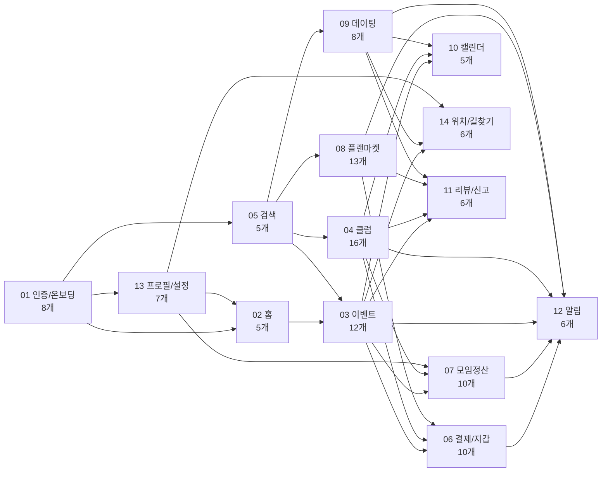

# Unit-backed 기능 인벤토리

<!-- release-document: reference -->
> **문서 구분: 기능·설계·절차 참고 문서.** 본문의 요구사항·과거 확인은 현재 미구현 목록이 아닙니다. 현재 작업 순서는 [앞으로 할 일](../../docs/plan/NEXT_WORK.md)을 따릅니다.

이 문서는 전체 21개 도메인·175개 기능 중 `business_logic/units/` 근거가 있는 14개 도메인·117개 기능을 모두 펼쳐 놓은 하위 집합 검산표다. 이 표에 없는 추가 7개 도메인과 F03·F04·F08·F11의 신규 기능을 포함한 총 58개 no-unit 기능은 실제 소스를 canonical로 삼는 source-first 계열이므로, 전체 누락 검산에는 [175개 기능 정의](../prd/00_prd_items/05_feature_definitions.md)를 함께 사용한다. 각 기능의 세부 정책은 별도 기능 카드로 확장한다.

## Unit-backed 커버리지 요약

| 영역 | 기능 수 | 원문 시나리오 수 | 원문 도식 수 |
|---|---:|---:|---:|
| 01 인증 & 온보딩 | 8 | 82 | 34 |
| 02 홈 피드 | 5 | 38 | 21 |
| 03 이벤트 | 12 | 115 | 55 |
| 04 클럽 | 16 | 191 | 62 |
| 05 검색 | 5 | 41 | 20 |
| 06 결제 & 지갑 | 10 | 71 | 45 |
| 07 모임 정산 | 10 | 84 | 53 |
| 08 플랜 마켓 | 13 | 125 | 58 |
| 09 프라이빗 데이팅 | 8 | 70 | 32 |
| 10 캘린더 | 5 | 40 | 26 |
| 11 리뷰 & 신고 | 6 | 39 | 27 |
| 12 알림 | 6 | 38 | 25 |
| 13 프로필 & 설정 | 7 | 35 | 26 |
| 14 위치 & 길찾기 | 6 | 42 | 24 |
| unit-backed 하위 집합 합계 | 117 | 1011 | 508 |

## Unit-backed 기능 흐름

## 01. 인증 & 온보딩

| ID | 기능 | 주 사용자 | 기획 검산 포인트 |
|---|---|---|---|
| F01-01 | 이메일 회원가입 & 로그인 | 신규/기존 사용자 | 가입 전 번호 확인·정보 검증과 가입 응답 뒤 내 정보 조회·세션 설치를 구분한다. 상태별 로그인과 응답 유실 복구를 확인한다. |
| F01-02 | 소셜 로그인 | 신규/기존 사용자 | 기존 Google 로그인·신규 가입·기존 이메일 연결과 각 단계의 취소·확인표 소비·늦은 결과를 구분한다. |
| F01-03 | 이메일 인증 | 신규 사용자 | 가입 전 번호 확인·재발송 제한·만료·오입력·발송과 실제 수신 구분 |
| F01-04 | 비밀번호 재설정 | 비로그인 사용자 | 계정별 메일 차이·확인표 만료/소비·비밀번호 규칙·세션과 AI 연결 해지 |
| F01-05 | 토큰 갱신 & 로그아웃 | 로그인 사용자 | 동시 갱신·응답 유실·일시 오류의 세션 유지와 명시적 거절을 구분하고, 로그아웃은 해당 세션·푸시만 정리한다. |
| F01-06 | 온보딩 | 첫 로그인 사용자 | 네 단계의 저장·건너뛰기·재개를 구분한다. 서버 완료 요청 실패를 앱이 확인하지 않는 차이와 단계별 부분 저장을 남겼다. |
| F01-07 | 관심사 태그 관리 | 로그인 사용자 | 카탈로그 태그의 본인 소유·20개 상한·단건 저장을 확인한다. 온보딩의 부분 저장과 프로필 쓰기 실패 안내, 화면 명세와의 차이는 남아 있다. |
| F01-08 | 소셜 계정 연결 해제 | 로그인 사용자 | 실제 연결과 활성 제공자를 구분하고, 마지막 수단·동시 해제·결과 유실을 확인한다. 비활성 수단 계산의 조건부 차이를 남겼다. |

## 02. 홈 피드

| ID | 기능 | 주 사용자 | 기획 검산 포인트 |
|---|---|---|---|
| F02-01 | 홈 피드 메인 조회 | 비로그인·로그인 사용자 | 핵심 네 결과와 회원별 보조 구역, 공개·위치·부분 실패·마켓 숨김을 구분한다. |
| F02-02 | 홈 피드 새로고침 | 비로그인·로그인 사용자 | 강제 갱신·5분 캐시·세대 변경·부분 실패와 별도 보조 공급자의 갱신 범위를 구분한다. |
| F02-03 | 홈 카드와 더보기의 이동·복귀 | 비로그인·로그인 사용자; 목적지 권한 적용 | 구역별 카드와 더보기 목적지, 추천 상세 중간 단계·보조 추천·출발 경로별 복귀를 구분한다. |
| F02-04 | 추천 이벤트 더보기·필터·더 읽기 | 로그인 사용자 | 추천 후보와 점수, 페이지별 필터·정렬·빈 첫 페이지·기간 이름·추천 이유의 차이를 명시한다. |
| F02-05 | 홈의 검색·알림 진입점 | 비로그인·로그인 사용자 | 공통 상단의 세 행동·검색 공개·알림 로그인·미읽음 실패·전체 메뉴 점·복귀와 갱신을 구분한다. |

## 03. 이벤트

| ID | 기능 | 주 사용자 | 기획 검산 포인트 |
|---|---|---|---|
| F03-01 | 이벤트 발견 & 탐색 | 참가자/게스트 | 검색/필터, 비로그인, 무한스크롤, 결과 없음 |
| F03-02 | 이벤트 상세 조회 | 참가자/게스트/호스트 | 호스트 CTA, DRAFT 접근, 종료/취소/비공개 상태 |
| F03-03 | 이벤트 생성 | 호스트 | 4단계 입력, 초안/발행, 유료/사전결제, 반복, 프라이빗 |
| F03-04 | 이벤트 수정/생명주기 관리 | 호스트 | 일정 변경, 취소/환불, 공지 throttle, 삭제 제한 |
| F03-05 | 이벤트 신청·참석·본인 취소 | 참가자 | 직접 참석·심사·결제 대기와 일행 배치, 재신청·일정 변경 동의·본인 취소의 결과를 구분한다. |
| F03-06 | 신청서 승인·거절과 일괄 처리 | 호스트·활성 공동호스트 | 호스트의 심사 권한·무료 배치·유료 결제 대기·사유 기록과 단건·일괄 실패 후 재시도를 구분한다. |
| F03-07 | 정원 & 대기열 관리 | 호스트/참가자 | 정원 변경, 수동 승격, 강제 제거, 모집 마감/재개 |
| F03-08 | QR 체크인 | 참가자/호스트 | QR 발급, 스캔, 단축코드, 수동 체크인, 시간 게이트 |
| F03-09 | 이벤트 사진첩 | 참석자/호스트 | 업로드 권한, 삭제 권한, 앨범 상태, 파일 실패 |
| F03-10 | 이벤트-플랜 연결 | 호스트 | 플랜 추가/순서/활성화, 권한, 연결 해제 |
| F03-11 | 위시리스트 | 참가자 | 낙관적 토글, 비로그인, 숨김/삭제 이벤트 |
| F03-12 | 내 이벤트 관리 & 참석 로그 | 참가자/호스트 | 주최/참석/지난 탭, 로그 페이지네이션, 상태별 카드 |

## 04. 클럽

| ID | 기능 | 주 사용자 | 기획 검산 포인트 |
|---|---|---|---|
| F04-01 | 클럽 발견 & 탐색 | 게스트/사용자 | 공개/비공개, 멤버십 상태, 빈 결과 |
| F04-02 | 클럽 상세 보기 & 가입 액션 | 게스트/사용자/멤버 | 가입/탈퇴/대기/차단/소유자 CTA |
| F04-03 | 클럽 생성·수정·삭제·소유권 이전 | 소유자 | 삭제 보상, 멤버 존재, 이전 수락/거절 |
| F04-04 | 멤버 관리 | 관리자/소유자 | 역할 변경, 추방, 자기 자신/소유자 보호 |
| F04-05 | 가입 대기열 승인/거절 & 초대 | 관리자/소유자 | 초대 만료, 중복 신청, 승인 알림 |
| F04-06 | 차단 관리 | 관리자/소유자 | 차단 시 자동 추방/환불, 해제, 자기 차단 방지 |
| F04-07 | 내 클럽 / 멤버 통계 | 멤버/관리자 | 내 클럽 탭, 통계 빈 상태, 권한 |
| F04-08 | 게시판 & 게시글 CRUD | 멤버/관리자 | 이미지 업로드, 고정, 삭제, 권한 |
| F04-09 | 게시글 댓글 & 대댓글 | 멤버/관리자 | 답글, 삭제, soft delete, 권한 |
| F04-10 | 공지사항 | 관리자/소유자 | 작성 권한, 고정, 멤버 알림 |
| F04-11 | 사진첩 | 멤버/관리자 | 앨범 CRUD, 사진 업로드, 삭제 권한 |
| F04-12 | 클럽 이벤트 & 캘린더 | 멤버/관리자 | 이벤트 발행, 자동 참가, 대기 승격, 통계 |
| F04-13 | 기금 현황 & 거래 차트 | 멤버/관리자 | 잔액/거래 차트, 인출 가능액 |
| F04-14 | 기부하기 & 기부 내역 | 멤버 | 지갑 차감, 취소, 기금 반영, 잔액 부족 |
| F04-15 | 기금 인출 요청 | 소유자 | 가용 잔액, pending 중복, 승인 위임 |
| F04-16 | 클럽 구독 | 멤버/관리자/소유자 | 시작/해지/재활성, 결제 실패, 만료 혜택 |

## 05. 검색

| ID | 기능 | 주 사용자 | 기획 검산 포인트 |
|---|---|---|---|
| F05-01 | 키워드 검색 | 검색 사용자; 사람 검색은 로그인 필요 | 실제 검색 입구·유형별 공개 조건·건수·정렬·더 읽기와 복귀를 구분한다. |
| F05-02 | 자동완성과 인기 모임 제목 제안 | 검색 사용자 | 자동완성의 두 대기 구간·후보·늦은 응답과 인기 모임 제목 태그를 구분한다. |
| F05-03 | 이벤트 검색 필터 | 검색 사용자 | 이벤트 전용 조건·임시 편집·건수 실패·좌표 누락·추천 힌트의 차이를 명시한다. |
| F05-04 | 최근 검색어 | 로그인 사용자 | 서버 기록 없이 계정별 기기 20개 저장·삭제·로그아웃 유지·탈퇴 정리를 구분한다. |
| F05-05 | 저장된 검색과 새 결과 알림 | 로그인 사용자 | 서버 10개 저장·조건 수정·실행 기록과 결과 조회 분리·알림 집계 차이를 명시한다. |

## 06. 결제 & 지갑

| ID | 기능 | 주 사용자 | 기획 검산 포인트 |
|---|---|---|---|
| F06-01 | 지갑 메인 조회 | 로그인 사용자 | 지갑·최근 세 거래의 별도 조회, 만료 무료 잔액 보정, 입구와 갱신·숨김 경계를 구분한다. |
| F06-02 | 포인트 충전 | 지갑을 충전하는 회원 | 주문·결제창·적립을 구분하고 확인 중 결과의 재충전 차단, 카드 선택과 실제 결제의 차이, 취소·복귀를 설명한다. |
| F06-03 | 거래 내역·상세·내보내기 | 로그인 사용자; 본인 거래 | 본인 거래의 페이지·필터, 상세 증감·취소 누계와 CSV의 별도 범위·날짜 경계를 명시한다. |
| F06-04 | 결제수단 관리 | 카드를 등록·관리하는 회원 | 서버 등록 세션과 결제사 인증, 5개 한도, 기본 지정·삭제·무효 카드와 자동충전 연결을 구분한다. |
| F06-05 | 자동충전 설정과 실행 | 자동충전을 설정한 회원 | 설정 저장과 실제 부족액 기준 실행, 카드·월 한도·확인 중 결과, 원 구매 재시도와 해제의 한계를 구분한다. |
| F06-06 | 참가비 지갑 결제·신청 취소·환불 | 참가비를 결제·취소하는 회원 | 신청별 참가비 결제와 취소, 서버 예상액·일행 추가분·지갑 반환과 계좌이체 반환 대기, 정산 영향을 구분한다. |
| F06-07 | 이벤트 개설권 구매·사용·반환 | 개설권을 구매·사용하는 회원 | 유료 잔액 구매·응답 유실 재시도·유효 목록, 실제 소비 원본의 반환과 남은 장 운영자 환불을 구분한다. |
| F06-08 | 개인 멤버십 구독·갱신·해제 | 개인 멤버십을 이용하는 회원 | 서버 가입 판정과 기간 구간, 지갑 차감·자동갱신·정지·해제, 가격 동의와 혜택 조회의 한계를 설명한다. |
| F06-09 | 수익 대시보드 조회 | 로그인 사용자; 본인 호스트 정산 | 지급 완료 수익과 상태 무관 최근 정산, 월별 12개월·정기모임 표시·갱신 한계를 구분한다. |
| F06-10 | 호스트 정산 내역·이의 제기 | 본인 정산을 가진 호스트 | 목록·요약 범위, 거절 정산 이의 접수와 운영자 승인 재개, 실패 사유 보존·지급 근거 복구를 구분한다. |

## 07. 모임 정산

| ID | 기능 | 주 사용자 | 기획 검산 포인트 |
|---|---|---|---|
| F07-01 | 모임 정산 생성 | 호스트 | 중복 정산, 복제, 참가자 선택, Quick-add |
| F07-02 | 정산 항목 관리 | 호스트 | DRAFT 편집, 항목/분담금, 최근 항목, 영수증 |
| F07-03 | 정산 활성화/취소 | 호스트 | DRAFT->ACTIVE, 납부 알림, 취소/환불 |
| F07-04 | 정산 현황/요약/영수증 조회 | 호스트/참가자 | 요약, 참여자 상태, 영수증 권한 |
| F07-05 | 분담금 납부 | 참가자 | 포인트, 계좌이체, 혼합 결제, 재발행/환불 |
| F07-06 | 이체 확인/일괄 확인/상각 | 호스트 | 수동 확인, 일괄 처리, 완료 전이, 회수불가 |
| F07-07 | 미납자 리마인드/마감 연장 | 호스트 | 독촉 대상, 연장 제한, 이력 |
| F07-08 | 이의제기/처리/감사로그 | 참가자/호스트 | 이의 상태, 처리 권한, 감사로그 |
| F07-09 | 선입금/환불/환불규정 | 호스트/참가자 | 사전 결제, 확인, 환불률, webhook |
| F07-10 | 정산 계좌/이력/호스트 신뢰도 | 호스트/참가자 | 기본 계좌, 월별 요약, 신뢰도 노출 |

## 08. 플랜 마켓

| ID | 기능 | 주 사용자 | 기획 검산 포인트 |
|---|---|---|---|
| F08-01 | 내 플랜 목록 관리 | 크리에이터/구매자 | 만든 플랜/구매 플랜 탭, 새 플랜 |
| F08-02 | 플랜 상세/작성자용 미리보기 | 크리에이터 | DRAFT/PUBLISHED, 복사, 숨김 |
| F08-03 | 블록 에디터 | 크리에이터 | 블록 CRUD, 자동저장, 삭제/복구, 타입 변환 |
| F08-04 | 블록 드래그 재정렬 | 크리에이터 | 순서/계층 이동, 저장 실패 복구 |
| F08-05 | 플랜 발행 | 크리에이터 | 발행 요건, 중복 발행, 체크리스트 |
| F08-06 | 마켓 아이템 관리 | 크리에이터 | 등록/수정/판매중지/재개/삭제 |
| F08-07 | 크리에이터 프로필/통계 | 크리에이터/구매자 | 공개 프로필과 본인 통계 구분 |
| F08-08 | 마켓 메인 탐색 | 구매자 | 카테고리, 인기/최신, 빈 결과 |
| F08-09 | 마켓 검색 | 구매자 | 키워드, 정렬, 필터 |
| F08-10 | 마켓 아이템 상세 | 구매자 | 커버, 설명, 리뷰, 번들, 자기 상품 |
| F08-11 | 아이템·번들·플랜 구매 | 구매자 | 잔액 부족, 이미 구매, 부분 중복 |
| F08-12 | 내 컬렉션 | 구매자 | 활성/비활성, 만료 임박, 미리보기 |
| F08-13 | 구매 플랜 -> 이벤트 생성/리뷰 | 구매자 | 소유권, 이벤트 정보 복사, 리뷰 중복 |

## 09. 프라이빗 데이팅

| ID | 기능 | 주 사용자 | 기획 검산 포인트 |
|---|---|---|---|
| F09-01 | 본인 인증 | 데이팅 사용자 | 인증 요청/검증, 미성년/실패, 재인증 |
| F09-02 | 데이팅 프로필 관리 | 데이팅 사용자 | 사진, 소개, active 토글, 미인증 차단 |
| F09-03 | 후보자 스와이프 & 매칭 액션 | 데이팅 사용자 | LIKE/PASS, 상호 매칭, 일일 한도 |
| F09-04 | 매칭 목록 조회 | 데이팅 사용자 | 새매칭/대화중, 차단/만료 상태 |
| F09-05 | 채팅 | 매칭 사용자 | 메시지, 읽음, 중복 전송, 차단 |
| F09-06 | 만남 제안 & 안전 흐름 | 매칭 사용자 | 제안/수락/거절, 일정/장소, 안전 기능 |
| F09-07 | 사용자 차단/해제 | 데이팅 사용자 | 후보/매칭/채팅 어디서든 차단, cascade |
| F09-08 | 내 프로필 조회 이력 | 데이팅 사용자 | 조회자 목록, 차단/비활성 사용자 필터 |

## 10. 캘린더

| ID | 기능 | 주 사용자 | 기획 검산 포인트 |
|---|---|---|---|
| F10-01 | 월간/일간 통합 캘린더 조회 | 로그인 사용자 | 이벤트/가용성/데이팅 합산, 오늘, 캐시 |
| F10-02 | 일정 항목 라우팅 | 로그인 사용자 | itemType별 상세 이동, referenceId 없음 |
| F10-03 | 단일 가용 시간 CRUD | 로그인 사용자 | 시간 검증, 충돌, force delete |
| F10-04 | 반복 가용 시간 규칙 관리 | 로그인 사용자 | 주기/요일, 미리보기, 인스턴스 충돌 |
| F10-05 | 타 사용자 가용성 공개 조회 | 로그인/게스트 | 공개/친구 범위, 자기 자신, 빈 결과 |

## 11. 리뷰 & 신고

| ID | 기능 | 주 사용자 | 기획 검산 포인트 |
|---|---|---|---|
| F11-01 | 이벤트 리뷰 작성 | 참석자 | 참석자 자격, 중복, 부적절 콘텐츠 |
| F11-02 | 리뷰 목록 조회 | 사용자 | 이벤트별/사용자별, 평균/분포, 신고 진입 |
| F11-03 | 리뷰 수정 & 삭제 | 작성자 | 수정 한도, 타인 리뷰 차단, 삭제 후 점수 |
| F11-04 | 신고 | 로그인 사용자 | 대상 유형, 자기 신고, 중복 신고, 운영 접수 |
| F11-05 | 신뢰점수 & 변동 이력 | 사용자 | 본인/타인 노출 차이, 등급 임계, 이력 |
| F11-06 | 취향 평가 & 취향 프로필 | 로그인 사용자 | 비공개 평가, 태그 가중치, 데이터 부족 |

## 12. 알림

| ID | 기능 | 주 사용자 | 기획 검산 포인트 |
|---|---|---|---|
| F12-01 | 알림 목록 조회 & 읽음 관리 | 로그인 사용자 | 딥링크, 모두 읽음, 삭제, 무한스크롤 |
| F12-02 | 알림 그룹 보기 & 미읽음 배지 | 로그인 사용자 | 그룹 토글, 배지 감소, 빈 인박스 |
| F12-03 | 카테고리별 알림 설정 | 로그인 사용자 | 카테고리와 내부 타입 매핑, 실패 원복 |
| F12-04 | 방해금지 시간 설정 | 로그인 사용자 | 자정 넘김, 요일, 카테고리 설정과 중첩 |
| F12-05 | FCM 디바이스 토큰 등록 & 기기 관리 | 로그인 사용자 | 다중 기기, 토큰 갱신, 로그아웃 해제 |
| F12-06 | 알림 권한 인라인 안내 배너 | 로그인 사용자 | OS 권한, 설정 진입, lifecycle 재확인 |

## 13. 프로필 & 설정

| ID | 기능 | 주 사용자 | 기획 검산 포인트 |
|---|---|---|---|
| F13-01 | 마이페이지와 프로필 탐색 | 로그인 사용자 | 허브·상세의 메뉴, 성향·만난 사람, 받은 후기·작성 글·계정별 복귀를 구분한다. |
| F13-02 | 프로필 편집과 사진 변경 | 로그인 사용자 | 닉네임·소개·MBTI·사진의 저장·이탈과 계정 전환을 구분한다. |
| F13-03 | 주소 추가·수정·기본 주소 관리 | 로그인 사용자 | 10개 상한·주소 좌표·기본 지정·이름표 잔존·실패 안내 차이를 구분한다. |
| F13-04 | 선호 태그 관리 | 로그인 사용자 | 내 프로필의 단건 추가·삭제·20개 상한·조회 오류와 쓰기 실패 안내 누락을 구분한다. 공통 저장·추천 규칙은 관심사 PRD를 따른다. |
| F13-05 | 데이터 내보내기 | 로그인 사용자 | 처리중/완료/실패/만료, 다운로드 |
| F13-06 | 계정 삭제 요청과 취소 | 로그인 사용자 | 사전 의무·보관금 동의, 예약·취소·제재 중 지연과 부분 정리·외부 완료를 구분한다. |
| F13-07 | 계정 즉시 탈퇴 | 로그인 사용자 | 사전 점검·조건부 동의·잠금 뒤 재판정, 부분 정리·응답 유실·기기 정리와 유예 파기를 구분한다. |

## 14. 위치 & 길찾기

| ID | 기능 | 주 사용자 | 기획 검산 포인트 |
|---|---|---|---|
| F14-01 | 이벤트 참석자 위치 공유 | 참석자/호스트 | opt-in, 30초 갱신, 시간 게이트, 권한 |
| F14-02 | 위치 공유 중지 | 참석자 | opt-out, 데이터 제거, 자동 만료, 재개 |
| F14-03 | 위치 공유 만료 연장 | 참석자 | 연장 한도, 만료 후 시도, 알림 |
| F14-04 | 위치 프라이버시 대시보드 | 참석자/호스트 | 이벤트별 토글, 호스트 분기, 실패 롤백 |
| F14-05 | 이벤트 길찾기 | 참석자/호스트 | 현재 위치/저장 주소, 외부 지도, 참석자 거리 |
| F14-06 | 역지오코딩 | 위치 입력 사용자 | 캐시, 좌표 오류, 외부 API 장애 |
