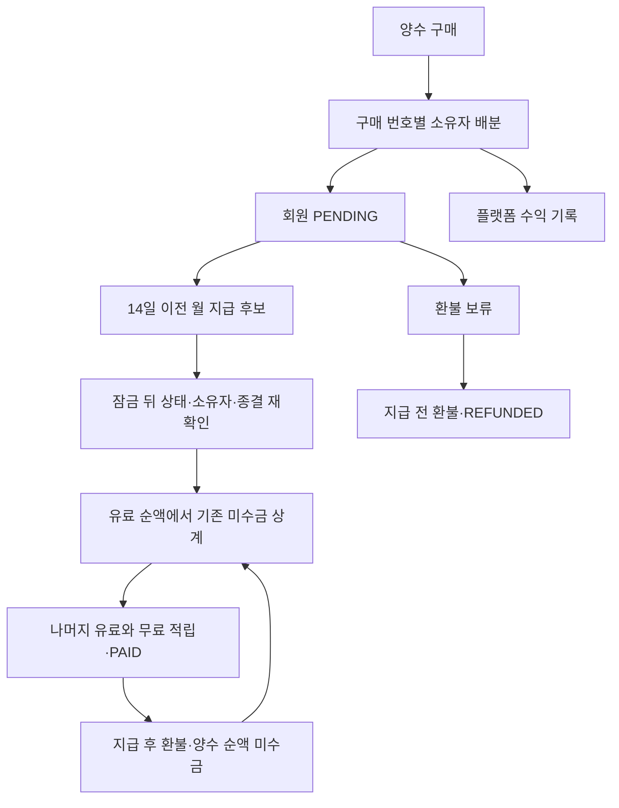

# F08-15. 크리에이터 매출 귀속·정산 PRD

<!-- release-document: reference -->
> 2026-11-22 소스 대조. 구매·배분·월 지급·환불 미수금의 현재 계약이다. 이번 문서 갱신은 새 실제 거래·시험 통과 기록이 아니다. 작업 순서는 [앞으로 할 일](../../../../docs/plan/NEXT_WORK.md)을 따른다.

## 적용 범위와 실행 입구

상품 단건·번들·플랜 직접 구매는 구매 트랜잭션 안에서 수익을 기록한다. 이 문서의 입구는 별도의 운영자 수동 보정 화면이 아니라 [상품·번들·플랜 구매](F08-11_purchase_prd.md), 서버 월 지급 스케줄러, [구매 환불](F08-14_purchase-refund_prd.md)이다. 기존 문서의 sourceId 변경·상태 추가·FLOW_THROUGH 전환은 이미 반영된 계약이며 신규 구현 목록이 아니다.

월 지급은 크리에이터 지갑에 유료·무료 포인트를 적립하는 처리다. 은행 출금, 세금 신고, 실제 알림 수신까지 완료했다는 뜻은 아니다. 모임·정기모임·제공자 거래는 같은 수익 모델을 사용해도 월 마켓 지급의 대상과 상태 규칙이 다르다.

## 코드 위치

구매 생성은 `MarketPurchaseService`, `MarketPurchaseCommand`, `PlanPurchaseService`, `PlanCreatorEarningAdapter`, 가격·수수료는 `PricingDecision`, `FeePolicyType`, `SpendPolicyRegistry`를 따른다. 수익 모델·상태는 `CreatorEarning`, `CreatorEarningSourceType`, `EarningStatus`, `EarningTransitions`가 기준이다. 지급은 `MarketplaceSettlementBatchScheduler`, `MarketplaceSettlementService`, `CreatorPayoutCommand`, `CreatorEarningQueryRepository`, 장부는 `MarketplaceLedgerFacade`, 환불 연결은 `MarketRefundCommand`를 대조했다.

기존 시험 중 `MarketplaceSettlementBatchSchedulerTest`, `EarningTransitionsRefundTest`, `CreatorPayoutPathCommitTest`의 해당 단언을 읽었다. 구매 근거는 같은 소스 버전의 F08-11 대조를 재사용했다. 이 기능만을 위한 외부 수익 생성 API는 문서에 추가하지 않는다.

## 구매별 수익 소유자와 원천 식별

| 구매 | sourceType / sourceId | 수익 행의 소유자와 개수 |
| --- | --- | --- |
| 상품 단건 | MARKET_ITEM / MarketPurchase 구매 번호 | 구매 시 승인 버전 상품의 소유자에게 1행 |
| 번들 | MARKET_BUNDLE / MarketPurchase 구매 번호 | 구성품별 소유자에게 행 생성. bundleItemId와 allocationRatio 보관 |
| 플랜 직접 | PLAN_DIRECT / PlanPurchase 구매 번호 | 플랜 창작자 회원에게 1행 |

위 수익 생성은 실제 결제액이 양수인 경로에 적용한다. 결제액 0인 구매도 구매·권리를 만들 수 있지만 차감·수익 행을 반드시 만든다고 보장하지 않는다. sourceId를 상품 ID나 구매 시각의 근사 매칭으로 해석하지 않는다.

소유자는 `owner_type=USER/PLATFORM`과 회원이면 `creator_user_id`에 저장한다. 자바 접근은 `owner()`와 회원 소유자 식별을 사용한다. 번들 대표 큐레이터와 매출 귀속자는 같다고 가정하지 않는다. 환불의 판매자 결정은 별도 정책이며 현재 `resolveSellerUserId`는 닫히지 않은 번들 판매자 후보를 우선하고 없으면 회원 소유자로 돌아간다. 모든 번들의 매출을 큐레이터 한 명에게 몰아주지 않는다.

## 유료·무료 배분과 계산

현재 구매 금액·통화의 기준은 [구매 가격과 포인트 사용 방식](F08-11_purchase_prd.md#가격과-포인트-사용-방식)이다. 상품과 플랜 직접 구매는 활성 상품 버전, 번들은 번들 가격을 사용한다. MARKET_ITEM·MARKET_BUNDLE·PLAN_PURCHASE의 SpendPolicy는 모두 FLOW_THROUGH다. 요청값 PAID만으로 실제 유료 전용 결제를 단정하지 않는다.

번들 구성품의 가중치는 **활성 버전 단가 × 구성 수량**이다. 가중치 합이 0이면 균등 비율을 사용한다. 총액 배분은 정수로 내리고 마지막 행에 나머지를 배정한다. 유료 배분은 각 행 총액의 비율에 따라 내린 다음 남은 유료액을 행의 여유 범위 안에서 배분한다. 무료액은 행 총액에서 유료액을 뺀다. 구매의 유료·무료 합계와 배분 행 합계가 각각 보존돼야 한다.

회원 소유 행의 계산은 다음과 같다. 현재 기본 요율을 설명한 것이며 세무 자문이나 외부 신고 완료 기록이 아니다.

| 값 | 현재 계산 |
| --- | --- |
| grossAmount | grossPaid + grossFree |
| platformFee | grossPaid × 10%, 정수 HALF_UP |
| withholdingTax | (grossPaid − platformFee) × 3.3%, 정수 HALF_UP |
| netAmount | grossPaid − platformFee − withholdingTax |
| 무료 적립 | grossFree 전액. 수수료·원천징수와 유료 미수금 상계 대상에서 분리 |

예를 들어 유료 10,000포인트인 회원 행은 수수료 1,000, 원천징수 297, 순액 8,703이다. 무료분만 있는 양수 거래는 netAmount=0이어도 무료 적립 대상이다. 번들 구매자에게 별도 보너스를 지급하는 계약은 없다. 창작자에게 지급하는 무료 매출분과 구매자 보너스를 혼동하지 않는다.

## 회원 판매와 플랫폼 판매 수익

플랫폼 소유 상품의 배분 행은 grossPaid/grossFree를 보존하지만 회원 수수료·원천징수·순지급액은 0이다. 플랫폼 유료 판매 수익은 MARKET_PLATFORM_REVENUE로 기록하고 무료분은 별도 장부 처리를 한다. 월 지급 조회는 USER 소유자만 고르며, 지급 명령에 플랫폼 행을 직접 섞으면 거절한다.

혼합 번들은 구성품의 소유자별로 회원 지급과 플랫폼 수익을 나눠 기록한다. 플랫폼 기간권은 판매 유형·승인 버전·권리의 조건을 함께 적용한다. [상품 관리의 플랫폼 기간권](F08-06_market-item-management_prd.md#회원-상품과-플랫폼-기간권) 및 구매 문서의 조건을 따른다. 수익 기록 코드가 있다는 사실만으로 판매 공개·운영 환불·실제 지급까지 완료 처리하지 않는다.

## 월 지급의 대상과 실패 경계

스케줄은 `0 0 3 1 * *`, 즉 스케줄러 환경 기준 매월 1일 03:00이다. 별도 시간대 확인 없이 한국 시각이라고 단정하지 않는다. 배치 잠금은 대기 5초·임대 600초이며 획득하지 못하면 이번 실행을 건너뛴다.

후보는 MARKET_ITEM·MARKET_BUNDLE·PLAN_DIRECT, USER 소유, PENDING, **createdAt < 현재 시각 − 14일**인 행이다. 정확히 경계 시각인 행은 `Before` 조건에 포함하지 않는다. 특정 지난달만 조회하는 방식이 아니므로 이전에 남은 후보도 포함한다. APPROVED·FAILED를 포함한 모든 미지급 상태를 자동 재시도한다고 확대하지 않는다.

회원별로 묶어 각 지급 트랜잭션을 호출한다. 한 회원 지급 실패는 다음 회원의 처리를 막지 않는다. 지급 시 지갑과 대상 수익·미수금 행을 잠그고 소유자, 지급 허용 상태, 환불 종결 여부를 다시 확인한다. 이미 지급되었거나 환불 종결된 행은 제외한다. 마켓 월 지급은 PENDING에서 PAID, 제공자 지급의 APPROVED 경로는 별도 계약이다.

## 장부·지갑·알림의 반영

구매 적립과 월 지급 분개를 같은 시점으로 적지 않는다. 회원 판매의 유료 미지급금은 구매 시 쌓고, 수수료·원천세 인식과 정산 처리는 지급 경로에서 수행한다. 지급 명령은 다음 값을 분리한다.

- 명목 순액: 대상 수익 행 netAmount 합계.
- 미수금 상계액: 명목 순액에서 먼저 갚는 금액.
- 실제 유료 지급: 명목 순액 − 상계액, 최솟값 0.
- 실제 무료 지급: grossFree 합계.

유료·무료 지급이 모두 0이어도 정산 거래를 기록해 전액 상계 등의 결과를 남긴다. 상계 분개, 정산 분개, 양수 유료 지갑 지급 분개, 수익 상태 변경은 지급 거래에 연결된다. 무료 적립에는 USER_WALLET/PROMOTION_EXPENSE 분개가 있다. 기존 문서의 단순한 `총액 × (1 − 수수료율 − 세율)` 식은 실제 순차 계산과 다르다.

`MarketplaceSettlementService`는 지급 결과에 따라 거래 번호를 키로 정산 완료·미수금 상계 알림을 outbox에 한 번 등록한다. 이는 알림 발송 의도의 저장이며 단말 수신 증거가 아니다. 판매현황 화면의 플랜 구매 매출 합계 또한 이 실제 지급 순액과 같지 않다. 표시 범위는 [크리에이터 프로필·판매현황](F08-07_creator-profile-stats_prd.md)을 따른다.

## 환불 보류·종결과 미수금

| 사건 | 현재 전이·기록 |
| --- | --- |
| 미지급 회원/플랫폼 행의 환불 신청 | PENDING → REFUND_HELD. 월 지급에서 제외 |
| 이미 지급된 회원 행의 환불 신청 | PAID 유지. 신청만으로 미수금을 만들지 않음 |
| 보류 해제 | REFUND_HELD → PENDING. PAID를 PENDING으로 되돌리지 않음 |
| 지급 전 환불 확정 | PENDING/REFUND_HELD → REFUNDED |
| 지급 후 회원 환불 확정, 순액 양수 | PAID → REVERSED. 원래 netAmount 보존 |
| 지급 후 회원 환불 확정, 순액 0 | PAID 유지하면서 환불 종결 기록. 유료 미수금 없음 |
| 미수금 전액 상계 | REVERSED → PAID. 환불 종결 표지는 유지 |
| 별도 미수금 손실 처리 | 허용된 REVERSED → WRITTEN_OFF. 월 지급의 자동 탕감 아님 |

환불 종결은 신청 번호·시각·실제 refundedPaid/refundedFree를 기록한다. 각 통화의 실제 환불액은 해당 행 총액을 넘을 수 없다. 이미 종결된 행의 재환불은 허용 전이가 아니다. 부분 환불은 선택된 구성품의 행을 종결하며, 환불 계획에서 제외된 보류 행은 해제한다. 환불 전체 권한·기한·분쟁 결정은 환불 문서에서 다룬다.

미수금 잔액은 `netAmount − offsetAppliedAmount`다. 상계 시 원금을 남은 금액으로 덮어쓰지 않는다. 다음 지급의 유료 순액에서 오래된 미수금(createdAt, id 순)부터 가능한 만큼 갚고 누적 상계액을 늘린다. 부족하면 REVERSED로 남고 전액 상계되면 PAID가 되어도 환불 종결 표지가 있으므로 다시 지급·환불할 수 없다. 무료 적립액으로 유료 미수금을 갚지 않는다.

전체 enum에는 PENDING·APPROVED·PAID·FAILED·REJECTED·REFUND_HELD·REFUNDED·REVERSED·WRITTEN_OFF가 있다. 상태 이름 하나만으로 지급 가능·환불 가능을 판정하지 않고 원천·소유자·종결 여부를 함께 본다.

## 처리 흐름

## 현재 제한과 확인 범위

| 구분 | 경계와 후속 확인 |
| --- | --- |
| 미검증 | 이번 갱신은 소스·선택된 기존 시험 단언 대조다. 배치 실행, DB 경합, 실제 지갑 지급·환불·알림 수신을 새로 실행하지 않았다 |
| 미검증 | 번들 0 가중치·잔액 보정·다중 소유자 혼합 결제의 전 조합 통과를 주장하지 않는다. 실제 구매 합계·배분·장부·권리를 같은 거래로 대조해야 한다 |
| 미검증 | 운영의 스케줄 시간대·600초 임대 이후 장시간 배치·중단 복구·세금 신고 결과는 코드 읽기만으로 완료하지 않는다 |
| 기준 | 현재 출시 설치 기준은 빈 DB다. 과거 문서의 구매 시각 근사 매칭 백필과 새 마이그레이션 결정을 현재 필수 작업으로 유지하지 않는다. 실제 이관이 생기면 해당 데이터·환경을 별도로 검토한다 |
| 기준 | 문서 갱신으로 MARKET·money.live 공개나 외부 지급을 실행하지 않는다. 공개 조건은 현재 출시 문서를 따른다 |

## 수용 기준과 검증 근거

- **AC-01 구매 원천:** 세 구매 경로가 상품 번호가 아닌 각각의 구매 번호로 수익을 식별한다. 양수 거래와 금액 0 구매의 기록 차이를 구분한다. 근거는 구매 서비스·명령·플랜 수익 어댑터다.
- **AC-02 번들 소유자:** 구성품별 소유자·bundleItemId·배분율을 보존한다. 대표 큐레이터가 전체 수익자가 되는 것으로 표시하지 않는다. 구매 명령의 배분 로직을 대조했다.
- **AC-03 배분 합계:** 정가 0은 균등 배분, 정수 잔액은 보정하고 행별/전체 유료·무료 합계를 보존한다. 코드를 대조했으며 전 경계값 새 실행 통과로 세지 않는다.
- **AC-04 회원 계산:** 수수료는 유료분, 원천징수는 수수료 차감 후 유료분으로 계산하며 무료분은 별도 적립한다. EarningTransitions·플랜 구매 계산·요율 근거를 재사용했다.
- **AC-05 플랫폼 제외:** 플랫폼 행의 회원 순지급액은 0이며 월 지급 후보에서 제외한다. 지급 명령도 플랫폼 행을 거절한다. 후보 조회와 rejectPlatformRows를 대조했다.
- **AC-06 월 지급 경계:** 세 원천·USER·PENDING·엄격한 14일 이전 조건을 적용한다. 배치 시험은 고정 시각의 컷오프 인자와 회원별 실패 격리를 단언한다. 이번에는 실행하지 않았다.
- **AC-07 지급 재확인:** 잠금 후 지급 상태·소유자·환불 종결을 확인하고 실제 지급·상계·무료 적립을 분리한다. 지급 명령과 장부 함수를 대조했다.
- **AC-08 환불 상태:** 보류·해제·지급 전후 환불을 구분하고 순액 0인 PAID 환불은 종결 표지만 남긴다. EarningTransitionsRefundTest의 해당 단언을 읽었다.
- **AC-09 원금 보존:** 정산 후 환불은 원래 순액을 보존하고 상계 누적액을 따로 기록한다. 전액 상계된 PAID의 환불 종결도 유지한다. CreatorPayoutPathCommitTest의 구매→지급→환불→다음 지급 단언을 읽었다.
- **AC-10 결과 표시:** 지갑 적립과 은행 출금, outbox 등록과 알림 수신, 구매 매출과 실제 순지급액을 구분한다. 지급 서비스·명령 및 이미 대조한 판매현황 계약이 근거다.

위 10개는 문서 수용 항목 수다. 기존 시험 코드를 읽은 범위와 신규 실행 결과를 구분하며, 이번 갱신에서 제품 시험은 실행하지 않았다.
