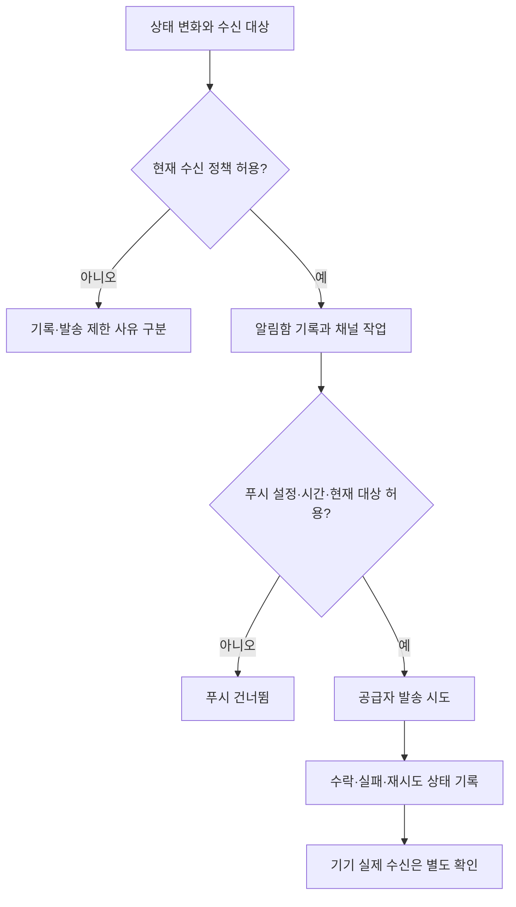

# 알림 정책 PRD

<!-- release-document: reference -->
> **문서 구분: 기능·설계·절차 참고 문서.** 본문의 요구사항·과거 확인은 현재 미구현 목록이 아닙니다. 현재 작업 순서는 [앞으로 할 일](../../../docs/plan/NEXT_WORK.md)을 따릅니다.

<!-- supporting-doc-status: 2026-09-02 -->

> 문서 상태: **보조 문서**. 기능별 현재 계약, source trace, Gap/Risk 판단은 [PRD_MIGRATION_STATUS.md](../PRD_MIGRATION_STATUS.md)와 각 기능 PRD를 우선한다. 이 문서는 인벤토리, 정책, QA, 기획 운영 기준을 보조하며, 기능 세부 판단은 [FEATURE_PRD_STANDARD.md](../FEATURE_PRD_STANDARD.md) 기준으로 재확인한다.

## 1. 목적

알림은 도메인 이벤트의 결과를 사용자에게 전달하는 보조 기능이다. 기획 시 알림 화면 자체보다 "누가, 언제, 왜 받아야 하는지"를 먼저 확정한다.

## 현재 수신 설정과 알림함의 관계

2026-11-22 서버·앱 대조 기준이다. 앱의 역할별 카테고리 스위치는 푸시와 알림함 기록을 함께 바꾸고 이메일 설정은 보내지 않는다. 한 카테고리는 한 요청·한 트랜잭션으로 저장한다. 실패하면 해당 임시 변경을 되돌린다. 이미 받은 알림을 삭제하지 않는다.

광고성 정보 수신 스위치는 수신 동의와 동의 이력도 함께 변경한다. 동의가 없는 광고 종류는 모든 채널이 꺼짐으로 조회되며 전달도 제한한다. 항상 전달하는 안전·계정 권리 알림은 일반 카테고리와 구분한다. 자세한 조건은 [카테고리별 알림 설정](../02_feature_prds/12_notification/F12-03_category-settings_prd.md)을 따른다.

알림함은 상단 아이콘에서 연다. 일반 목록·그룹 보기 모두 커서로 다음 알림을 받으며, 그룹 수는 현재까지 조회한 합계다. 배지의 차단 필터는 미읽음 1,000건 이하에 적용되고 이를 넘으면 필터 전 수를 쓴다. 읽음 실패 복구와 그룹 카드 갱신 제약은 [그룹 보기와 미읽음 배지](../02_feature_prds/12_notification/F12-02_notification-grouped-badge_prd.md)에 구분한다.

## 2. 알림 트리거

| 트리거 유형 | 예시 | 검토 기준 |
|---|---|---|
| 참여 상태 변경 | 이벤트 승인/거절, 대기열 승격 | 대상자와 호스트 모두 필요한지 확인 |
| 돈 상태 변경 | 결제 성공/실패, 환불, 정산 독촉 | 중요 알림으로 분류할지 확인 |
| 커뮤니티 활동 | 클럽 공지, 댓글, 초대 | 그룹핑과 배지 정책 확인 |
| 데이팅/안전 | 매칭, 채팅, 만남 제안, 차단 | 민감 정보 노출 최소화 |
| 계정/설정 | 데이터 내보내기 완료, 권한 회복 | 사용자가 다음 행동을 할 수 있어야 함 |

## 3. 기록과 발송 판단

카테고리 스위치를 끄면 새 푸시와 알림함 기록을 함께 끈다. 방해금지는 일반 푸시를 건너뛰는 조건이며 알림함 기록을 취소하지 않는다. 항상 전달하는 종류와 방해금지 예외는 각 정책으로 구분한다. 대상 회원 상태·차단 관계·광고 수신 동의·현재 도메인 상태도 발송 전에 확인한다.

서버는 알림함 기록, 채널 발송 작업, 공급자 수락, 실제 기기 표시를 같은 완료로 취급하지 않는다. 재시도는 대기 시각·만료·시도 한도에 따르며, 현재 처리자의 소유권을 확인한 결과만 종결한다. 관리자 재시도는 실패한 유효 작업을 다시 대기로 옮기고 처리자·사유를 남긴다. 현재 코드는 처리 소유자·임대 만료와 다음 시도 시각을 별도 필드로 관리한다. 옛 문서의 ‘한 컬럼으로 겸용’ 결함은 현재 구현 설명에서 제거한다.

근거는 `NotificationService`, `PushDeliveryEligibility`, `NotificationDeliveryJob`, `ChannelDeliveryStore`, `ChannelDeliveryWorker`다. 공급자 응답이나 서버 저장만으로 실기기 수신을 완료 처리하지 않는다.

## 4. 수용 기준

- 알림에는 사용자가 다음에 할 수 있는 행동이 명확해야 한다.
- 알림 딥링크 대상이 삭제/만료/권한 없음 상태일 때의 fallback이 있어야 한다.
- OS 권한 거부 상태에서도 앱 내 알림함 정책을 분리해서 정의해야 한다.

## 이동 목적지와 업무 결과

- 선입금 관련 알림은 참가자의 결제 화면과 운영자의 입금 확인 큐를 구분한다. 정기모임 관련 알림은 정기모임 식별자를 우선해 해당 화면으로 연결한다.
- 현재 이동 조율 알림은 통합 이동수단 화면으로 연결한다. 폐기된 카풀·버스 알림 번호를 현재 생산 계약으로 복사하지 않는다.
- 일정 변경 제안은 응답할 화면으로, 적용된 변경은 모임 상세로 안내한다. 별도 전용 화면이 없다는 이유만으로 정상적인 상세 안내를 결함으로 세지 않는다.
- 환불·분쟁·안전 체크인 알림의 현재 목적지는 앱 라우터와 해당 기능 명세를 따른다. ‘분쟁 알림 자체가 없음’이라는 옛 설명은 현재 계약으로 사용하지 않는다.
- 목적지 식별자가 없거나 접근할 수 없으면 안내한다. 아직 공개하지 않은 기능은 공개 범위 안내와 이동 제한을 적용한다. 알림이 있어도 대상 권한을 우회하지 않는다.

수신 대상과 생산 시점은 각각의 모임·정산·분쟁·커뮤니티 기능 명세가 정한다. 이 정책에 모든 알림 enum·payload·API를 중복 작성하지 않는다. 과거 번호별 배선 표는 Git 이력에서 확인하며 현재 미구현 목록으로 취급하지 않는다.

## 사용자가 확인하는 결과

알림함은 상단 아이콘에서 열고 목록·그룹 보기를 전환한다. 그룹 수는 조회한 알림의 누적 합계이며, 배지는 계정의 미읽음 수다. 읽음 실패 복구, 스와이프 삭제 실패, 그룹 카드의 갱신, 다른 세션 기기 삭제 등의 현재 제약은 [알림 도메인 요약](../01_domain_prds/12_알림_prd.md)과 기능 PRD를 따른다.

OS 권한 허용, 토큰 등록, 공급자 수락, 실제 수신은 각각 확인한다. 제품에 어떤 알림이 필요한지 결정하는 일과 해당 버전에서 실제 전달을 확인하는 일을 구분한다.
