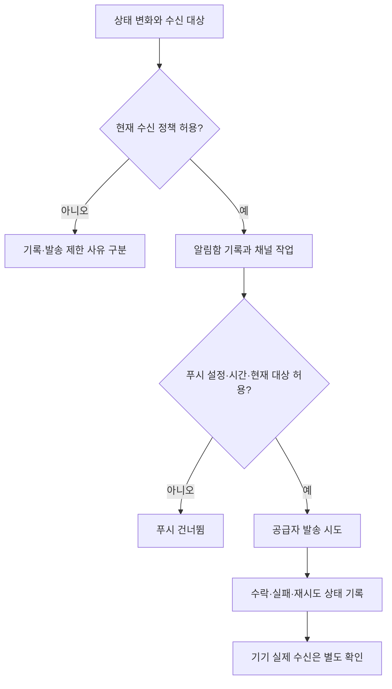

# 알림 정책 PRD

<!-- release-document: reference -->
> **문서 구분: 기능·설계·절차 참고 문서.** 본문의 요구사항·과거 확인은 현재 미구현 목록이 아닙니다. 현재 작업 순서는 [앞으로 할 일](../../../docs/plan/NEXT_WORK.md)을 따릅니다.

<!-- supporting-doc-status: 2026-09-02 -->

> 문서 상태: **보조 문서**. 기능별 현재 계약, source trace, Gap/Risk 판단은 [PRD_MIGRATION_STATUS.md](../PRD_MIGRATION_STATUS.md)와 각 기능 PRD를 우선한다. 이 문서는 인벤토리, 정책, QA, 기획 운영 기준을 보조하며, 기능 세부 판단은 [FEATURE_PRD_STANDARD.md](../FEATURE_PRD_STANDARD.md) 기준으로 재확인한다.

## 1. 목적

알림은 도메인 이벤트의 결과를 사용자에게 전달하는 보조 기능이다. 기획 시 알림 화면 자체보다 "누가, 언제, 왜 받아야 하는지"를 먼저 확정한다.

## 현재 수신 설정과 알림함의 관계

2026-11-22 서버·앱 대조 기준이다. 앱의 역할별 카테고리 스위치는 푸시와 알림함 기록을 함께 바꾸고 이메일 설정은 보내지 않는다. 한 카테고리는 한 요청·한 트랜잭션으로 저장한다. 실패하면 해당 임시 변경을 되돌린다. 이미 받은 알림을 삭제하지 않는다.

광고성 정보 수신 스위치는 수신 동의와 동의 이력도 함께 변경한다. 동의가 없는 광고 종류는 모든 채널이 꺼짐으로 조회되며 전달도 제한한다. 항상 전달하는 안전·계정 권리 알림은 일반 카테고리와 구분한다. 자세한 조건은 [카테고리별 알림 설정](../02_feature_prds/12_notification/F12-03_category-settings_prd.md)을 따른다.

알림함은 상단 아이콘에서 연다. 일반 목록·그룹 보기 모두 커서로 다음 알림을 받으며, 그룹 수는 현재까지 조회한 합계다. 배지의 차단 필터는 미읽음 1,000건 이하에 적용되고 이를 넘으면 필터 전 수를 쓴다. 읽음 실패 복구와 그룹 카드 갱신 제약은 [그룹 보기와 미읽음 배지](../02_feature_prds/12_notification/F12-02_notification-grouped-badge_prd.md)에 구분한다.

## 2. 알림 트리거

아래는 제품 검토에 사용할 트리거 예시다. 각 예시의 실제 발송 연결과 수신을 모두 확인했다는 뜻은 아니다. 데이터 내보내기는 현재 PRD의 요청·상태 조회 흐름이 확인 범위이며, 완료 알림의 실제 전달은 별도 근거가 필요하다.

| 트리거 유형 | 예시 | 검토 기준 |
|---|---|---|
| 참여 상태 변경 | 이벤트 승인/거절, 대기열 승격 | 대상자와 호스트 모두 필요한지 확인 |
| 돈 상태 변경 | 결제 성공/실패, 환불, 정산 독촉 | 중요 알림으로 분류할지 확인 |
| 커뮤니티 활동 | 클럽 공지, 댓글, 초대 | 그룹핑과 배지 정책 확인 |
| 데이팅/안전 | 매칭, 채팅, 만남 제안, 차단 | 민감 정보 노출 최소화 |
| 계정/설정 | 데이터 내보내기 완료, 권한 회복 | 사용자가 다음 행동을 할 수 있어야 함 |

## 3. 기록과 발송 판단

카테고리 스위치를 끄면 새 푸시와 알림함 기록을 함께 끈다. 방해금지는 일반 푸시를 건너뛰는 조건이며 알림함 기록을 취소하지 않는다. 항상 전달하는 종류와 방해금지 예외는 각 정책으로 구분한다. 대상 회원 상태·차단 관계·광고 수신 동의·현재 도메인 상태도 발송 전에 확인한다.

서버는 알림함 기록, 채널 발송 작업, 공급자 수락, 실제 기기 표시를 같은 완료로 취급하지 않는다. 재시도는 대기 시각·만료·시도 한도에 따르며, 현재 처리자의 소유권을 확인한 결과만 종결한다. 관리자 재시도는 실패한 유효 작업을 다시 대기로 옮기고 처리자·사유를 남긴다. 현재 코드는 처리 소유자·임대 만료와 다음 시도 시각을 별도 필드로 관리한다. 옛 문서의 ‘한 컬럼으로 겸용’ 결함은 현재 구현 설명에서 제거한다.

근거는 `NotificationService`, `PushDeliveryEligibility`, `NotificationDeliveryJob`, `ChannelDeliveryStore`, `ChannelDeliveryWorker`다. 공급자 응답이나 서버 저장만으로 실기기 수신을 완료 처리하지 않는다.

## 4. 수용 기준

- 알림에는 사용자가 다음에 할 수 있는 행동이 명확해야 한다.
- 알림 딥링크 대상이 삭제/만료/권한 없음 상태일 때의 fallback이 있어야 한다.
- OS 권한 거부 상태에서도 앱 내 알림함 정책을 분리해서 정의해야 한다.

## 이동 목적지와 업무 결과

- 선입금 관련 알림은 참가자의 결제 화면과 운영자의 입금 확인 큐를 구분한다. 정기모임 관련 알림은 정기모임 식별자를 우선해 해당 화면으로 연결한다.
- 현재 이동 조율 알림은 통합 이동수단 화면으로 연결한다. 폐기된 카풀·버스 알림 번호를 현재 생산 계약으로 복사하지 않는다.
- 일정 변경 제안은 응답할 화면으로, 적용된 변경은 모임 상세로 안내한다. 별도 전용 화면이 없다는 이유만으로 정상적인 상세 안내를 결함으로 세지 않는다.
- 환불·분쟁·안전 체크인 알림의 현재 목적지는 앱 라우터와 해당 기능 명세를 따른다. ‘분쟁 알림 자체가 없음’이라는 옛 설명은 현재 계약으로 사용하지 않는다.
- 목적지 식별자가 없거나 접근할 수 없으면 안내한다. 아직 공개하지 않은 기능은 공개 범위 안내와 이동 제한을 적용한다. 알림이 있어도 대상 권한을 우회하지 않는다.

수신 대상과 생산 시점은 각각의 모임·정산·분쟁·커뮤니티 기능 명세가 정한다. 이 정책에 모든 알림 enum·payload·API를 중복 작성하지 않는다. 과거 번호별 배선 표는 Git 이력에서 확인하며 현재 미구현 목록으로 취급하지 않는다.

## 사용자가 확인하는 결과

알림함은 상단 아이콘에서 열고 목록·그룹 보기를 전환한다. 그룹 수는 조회한 알림의 누적 합계이며, 배지는 계정의 미읽음 수다. 읽음 실패 복구, 스와이프 삭제 실패, 그룹 카드의 갱신, 다른 세션 기기 삭제 등의 현재 제약은 [알림 도메인 요약](../01_domain_prds/12_알림_prd.md)과 기능 PRD를 따른다.

OS 권한 허용, 토큰 등록, 공급자 수락, 실제 수신은 각각 확인한다. 제품에 어떤 알림이 필요한지 결정하는 일과 해당 버전에서 실제 전달을 확인하는 일을 구분한다.

## 광고 수신 동의와 처리 결과

2026-11-22 코드 기준으로 광고 동의를 요구하는 알림 종류는 `PROMOTION`이다. 앱의 **광고성 정보 수신**과 **추천 알림**은 다른 스위치다. 추천 알림은 저장한 검색의 새 결과와 관심 있는 사람의 새 모임을 묶으며, 현재 코드에서는 광고 동의 대상으로 분류하지 않는다. 이는 구현의 분류이며 모든 콘텐츠의 법적 성격을 일괄 판정한 결과가 아니다.

광고 스위치는 푸시와 알림함 설정을 함께 보낸다. 서버는 두 채널이 모두 켜졌을 때 동의로 반영하며, 이메일만 수정하는 요청은 동의 자체를 바꾸지 않는다. 설정에서 동의 값이 실제로 달라지면 `SETTINGS` 이력을 추가한다. 이미 같은 동의 상태를 다시 저장하는 것은 새 동의 이력·결과 통지를 만드는 명령이 아니다. 동의하지 않은 광고 종류는 조회 시 모든 채널을 꺼짐으로 반환한다.

가입·재동의·설정 변경·메일 수신 거부에서 광고 동의 이력이 생길 때 같은 트랜잭션으로 `MARKETING_CONSENT_RESULT` 발송 의도를 기록한다. 이력 번호를 중복 방지 키로 쓰고, 동의·최초 거부·기존 동의 철회를 구분해 전송자 이름·날짜·처리 결과를 만든다. 재동의 요청에서 광고 항목을 생략하면 광고 동의 이력을 추가하지 않는다. 결과 알림은 일반 채널 끄기와 구분되는 항상 전달 종류지만, 현재 수신자 자격·단말 권한·발송 처리까지 모두 우회하는 것은 아니다. **즉시 의도 저장은 즉시 실수신이나 통지 기한 준수의 증거가 아니다.**

## 주간 요약 메일의 대상과 발송 한계

주간 요약은 월요일 오전 9시의 서버 기본 시간대 스케줄이다. 한국 시간으로 고정된 방해금지 계산과 혼동하지 않는다. 최근 일주일에 알림이 생성된 회원 번호를 500명씩 조회하며, 한 번에 최대 5,000명 또는 10분 예산으로 제한한다. 한도를 넘긴 나머지를 같은 주에 이어 보내는 저장 커서는 없다. 제목은 주간 요약이지만 본문의 참석 수는 `countAttendingEvents` 결과, 미읽음 수는 현재 알림 서비스 결과다. 이 수치 모두를 일주일 동안의 새 활동 수로 해석하지 않는다.

선별 시점과 비동기 메일 작업이 시작될 때 광고 동의 및 `PROMOTION` 이메일 설정을 확인한다. 설정 행이 없으면 이메일은 허용으로 보지만 동의는 반드시 필요하다. 주소가 없으면 보내지 않는다. 두 번째 확인 이후 실제 전송까지 발생하는 철회를 원자적으로 차단한다고 보장하지 않는다.

제목 앞에 `(광고)`를 붙이고 본문에는 전송자 이름·주소·전화·이메일과 한글·영문 수신 거부 안내를 넣는다. 발송자 설정은 빈 문자열을 거절하지만 개발용 기본값도 있으므로 설정 검증 통과를 운영 발송자 정보 확정으로 쓰지 않는다.

이 메일 경로는 일반 업무 알림의 영속 채널 작업과 다르다. 비동기 실행기 거절은 집계·로그를 남기며 자동 재처리를 예약하지 않는다. 메일 전송기는 수신 억제 주소를 건너뛰고, 공급자 전송 호출의 성공·실패 기록을 남긴다. 스케줄러의 제출 수는 실제 전송 성공 수가 아니며, `SENT`도 받은편지함 도착을 증명하지 않는다. 현재 이 경로에 영속 발송 큐의 재시도 보장이 있다고 설명하지 않는다.

## 로그인 없는 메일 수신 거부

메일의 수신 거부 주소는 `GET /api/v1/marketing/unsubscribe?t=...`에서 확인 화면을 보여 주고 같은 주소의 `POST`에서 처리한다. 두 요청은 로그인 없이 허용된다. GET만으로 동의를 철회하지 않는다. 메일에는 `List-Unsubscribe`와 한 번 누르기 헤더를 넣으며 해당 주소의 POST를 사용한다. 메일 프로그램에서 실제 단추가 노출되고 정상 작동하는지는 별도 실행 확인이다.

서버는 회원 번호와 용도가 결합된 HMAC 서명을 검증한다. 토큰 자체의 만료 시각은 없으며 서명에 사용하는 비밀 변경의 영향을 받는다. 잘못된 토큰은 400, 실제 동의 철회와 이미 거부 상태는 서로 다른 안내의 200이다. 실제 철회에만 동의 값·변경 시각·`EMAIL_UNSUBSCRIBE` 이력·결과 통지를 함께 기록한다. 반복 요청으로 이력을 계속 늘리지 않는다. 이 주소는 광고 전체의 수신 동의를 철회하며 주간 메일 한 종류의 설정만 끄는 주소가 아니다.

## 수신 동의 재확인의 시점과 실패 경계

매일 오전 10시 서버 기본 시간대 작업이 최신 광고 동의 이력이 동의이고 현재 동의 값도 켜진 회원을 대상으로 삼는다. 동의일의 매 2년 해당일을 기준으로 **30일 전부터 30일 후까지**를 처리 창으로 계산한다. 매 주기마다 이력 번호와 회차로 중복을 막는다. 기록 직전에 동의를 잠그고 최신 이력이 그대로인지 다시 확인한다. 동의 값만 있고 이력이 없는 회원은 날짜를 입증할 수 없어 건너뛰며 경고 수를 남긴다.

`MARKETING_CONSENT_RECHECK`는 일반 설정으로 끄는 알림과 구분되며, 전송자·동의일·동의 유지와 철회 방법을 안내한다. 의도를 저장한 뒤 주소가 있으면 별도의 비동기 메일도 요청한다. 유지에는 새 동의 요청이 필요 없고 철회는 앱 설정 또는 수신 거부 주소에서 한다.

**의도 저장 뒤 메일 제출·전송이 실패해도 다음 스케줄은 이미 기록된 회차로 판단해 메일을 다시 요청하지 않는다.** 알림 의도와 메일을 하나의 영속 전달 작업으로 취급하지 않는다. 처리 창 전체가 지나면 해당 회차를 일반 스케줄에서 보충한다는 보장도 없다. 따라서 ‘모든 회원에게 2주년 전에 전달 완료’라는 과거 설명을 현재 동작으로 사용하지 않는다.

## 법령 대조 범위와 기존 출시 결정

국가법령정보센터의 [정보통신망법 시행령 수신동의 관련 조문](https://www.law.go.kr/LSW/lsInfoP.do?efYd=20261002&lsiSeq=290483) 검색 본문에서 제62조의2의 처리 결과 14일 이내 통지와 제62조의3의 매 2년 해당일 전 확인 기준을 확인했다. 조문 페이지의 전체 본문은 이번 열람에서 표시되지 않았다. 코드의 해당일 이후 30일 처리 창은 이 법정 기한을 연장하는 근거가 아니다. 실제 기한 내 전달·누락 복구를 확인하기 전에는 준수 완료로 표시하지 않는다.

[시행령 별표 6의 광고 표시와 수신 거부 방법](https://www.law.go.kr/LSW/flDownload.do?flSeq=169802551)은 원문을 확인했다. 전자우편 제목의 광고 표시, 발송자 식별 정보, 한글·영문 안내와 간편한 거부 수단을 메일 구성 코드와 대조했다. 실제 운영 정보·메일 클라이언트·수신함 검증이나 법령 전체 검토를 완료했다는 뜻은 아니다.

기존 문서의 결정 Q10은 출시 전 광고 푸시·인앱 방송 입구를 열지 않고, 광고 푸시를 열 때 야간 전송 제한과 광고 표기를 함께 갖추는 계획이다. 이 계획을 서버의 광고 판정 기능이 없다는 설명으로 바꾸지 않는다. Q11의 주간 광고 메일·재확인, Q12의 처리 결과 통지, Q13의 동의·추천 스위치 분리는 위 현재 구현과 각각 대조했다. 실제 공개 여부와 운영 준비는 [첫 출시 현황](../../docs/qa/launch-status.html)을 따른다.

## 이번 광고 정책 대조의 근거

동의 기록은 `PolicyConsentService`와 `NotificationSettingService`, 재확인은 `MarketingConsentRecheckService`·스케줄러·후보 조회, 요약은 `WeeklyDigestScheduler`·수신자 조회·메일 발송기, 수신 거부는 `MarketingUnsubscribeController`·`MarketingUnsubscribeLink`, 메일 구성·결과는 `AdvertisingMailFormat`·`EmailMessageComposer`·`EmailDispatcher`를 읽었다. 앱의 두 스위치와 일괄 변경 요청도 대조했다. 상세 소스 범위와 해시는 [전체 문서 최신화 기록](../../verification/document-refresh-2026-11-22.json)의 알림 광고 정책 근거에 기록한다. 제품 코드 수정·메일 발송·브라우저·기기 시험은 실행하지 않았다.

## 실제 지갑 반환 완료의 알림

정산 취소와 지갑 반환 완료는 다른 사건이다. 송금·분담의 반환 거래에서 실제 지갑 이동액이 양수인 경우에만 `MEETING_SETTLEMENT_REFUND_COMPLETED` 발송 의도를 양쪽 당사자에게 기록한다. 원래 납부자에게는 지갑 환불, 원래 수취자에게는 지갑에서 반환한 금액을 안내한다. 송금은 실제 돌려준 잔여 포인트와 장부에 적립돼 있던 가상계좌 은행분을 합산하며, 외부 은행 직접 반환이 남아 있으면 지갑 완료 알림이 그 의무를 없애지 않는다.

수신자별 송금/분담 식별자로 발송 의도 중복을 막는다. 이것은 공급자 수락 뒤 장애로 재전달될 가능성이나 모든 기기의 정확히 한 번 표시를 보장하는 계약이 아니다. 실제 이동액이 0이거나 반환 거래가 실패한 경우를 완료 알림으로 바꾸지 않는다.

앱이 현재 계정의 전경 푸시를 처리하면 지갑·거래 목록·정산 관련 조회를 갱신하는 변경 신호를 올린다. 신호 발생과 조회 성공은 별개이며 백그라운드에서도 즉시 같은 화면이 새로 그려진다고 일반화하지 않는다. 누르면 유효한 shareId를 우선해 분담 상세, 그다음 transferId로 송금 상세를 열고 둘 다 없으면 지갑의 모임 정산 목록으로 보낸다. 현재 내역과 권한은 목적지에서 다시 확인한다. [취소·반환·결과 불명 복구](../../docs/domains/07-settlement.html#wallet-reversal-completed)와 같은 기준이다.

## 본인확인 수동 승인과 자격 해제 알림

관리자의 수동 승인 거래는 본인에게 `DATE_VERIFICATION_MANUAL_APPROVED`, 기존 수동 승인을 해제하는 거래는 `DATE_VERIFICATION_MANUAL_REJECTED` 의도를 기록한다. 후자의 현재 제목은 본인확인 자격 해제이며 인증 상태를 EXPIRED로 바꾼다. enum의 REJECTED를 모든 증빙 제출의 반려 알림으로 해석하지 않는다. 같은 관리 명령 키의 재생은 의도 생성 전에 기존 결과를 반환한다.

의도는 관리자 알림 보관함에 같은 거래로 저장하며, 탈퇴·탈퇴 진행 중인 대상은 적재 단계에서 제외한다. 두 종류는 관리자 심사 결과로서 일반 카테고리와 구분하지만 현재 대상·기기·채널 조건과 실제 전달은 별도다. payload에는 verificationId를 넣으며 생년월일·성별·증빙 파일·운영자 처리 사유를 이 통지에 싣지 않는다.

두 알림은 일반 본인확인 상태 화면으로 보낸다. 승인 뒤 접근 조건이 달라지는 수동 증빙 제출 화면으로 바로 보내지 않는다. 현재 푸시 갱신 표에는 이 두 종류의 인증 상태 갱신 연결이 없어 이미 열린 화면이 결정 푸시만으로 즉시 바뀐다고 보장하지 않는다. 재진입·재조회로 현재 상태를 확인하며 실제 기기 수신·복귀는 별도 검증 대상이다. [본인 인증의 현재 계약](../02_feature_prds/09_private_date/F09-01_verification_prd.md)을 함께 따른다.

## 마일리지 사진 심사와 반복 적립 판정의 알림

| 사건 | 의도 대상과 종류 | 앱 목적지·결과 경계 |
| --- | --- | --- |
| 사진 반려·재심 뒤 최종 반려 | 사진 심사 대상 본인에게 PhotoReviewRejected / CLUB_MILEAGE_REVIEW_QUEUE | eventId가 있으면 모임 사진첩, 없으면 클럽 마일리지. 심사 거절 사유는 통지 본문에 포함할 수 있음 |
| 본인의 재심 요청 | 발송 처리 시 조회한 현재 클럽장에게 PhotoReviewReappealRequested / CLUB_MILEAGE_REVIEW_QUEUE | 클럽 운영 사진 심사 목록. 모든 보상 담당자에게 일괄 전송하는 계약이 아님 |
| 사진 승인 | 실제 적립 원장을 만든 경우 MileageEarned / CLUB_MILEAGE_UPDATED | 클럽 마일리지. 제도·규칙 비활성 또는 한도 초과면 승인 상태와 적립 생략 사유를 남기므로 승인만으로 적립 통지를 보장하지 않음 |
| 사진 승인 취소 | 새 정정 원장을 만든 경우 MileageReversed / CLUB_MILEAGE_UPDATED | 클럽 마일리지. 적립 원장이 없거나 기존 정정을 재연결하면 사진 승인 취소 전용 알림을 추가하지 않음 |
| 반복 수동 적립 검토 종결 | 현재 클럽장에게 ReviewQueueProcessed; 실제 회수에는 대상 회원의 원장 정정 알림 | 운영 검토 목록과 회원 마일리지를 구분. 잔액 부족분은 별도 회수 검토 큐로 넘길 수 있어 원래 검토의 종결이 전액 회수 완료와 같지 않음 |

사진 반려·재심 의도는 상태 변경·감사와 함께 저장한다. 재심은 REJECTED에서 한 번 요청하고, 재심 뒤 반려는 REJECTED_FINAL로 닫는다. 사진 검토 목록·반려는 마일리지 관리 권한, 승인·취소는 보상 권한을 요구하며 자기 사진의 운영 판정은 막는다. 재심 요청의 수신자가 클럽장이라는 사실과 실제 열람·집행 권한 검사를 구분한다.

반복 수동 판정은 행위자·명령 키·내용 지문을 대조하며 같은 요청은 기존 결과를 돌려준다. 정정·감사·검토 종결·의도 저장은 거래 경계를 공유하지만 모든 선택 원장의 회수가 반드시 발생하는 것은 아니다. 사진 심사와 반복 판정의 상태·원장 중복 방지를 실제 기기의 알림 중복 방지와 혼동하지 않는다. [마일리지 적립·차감·정정·배지 집행](../02_feature_prds/16_mileage/F16-06_grant-redeem-reverse_prd.md)과 연결해 판단한다.

이번 대조는 사진 심사 서비스·상태 전이·원장 알림 생성, 공통 발송 매핑과 앱 목적지의 소스 확인이다. 실제 사진 파일, 운영 심사, 실기기 푸시, 앱 복귀를 실행한 결과는 아니다.
