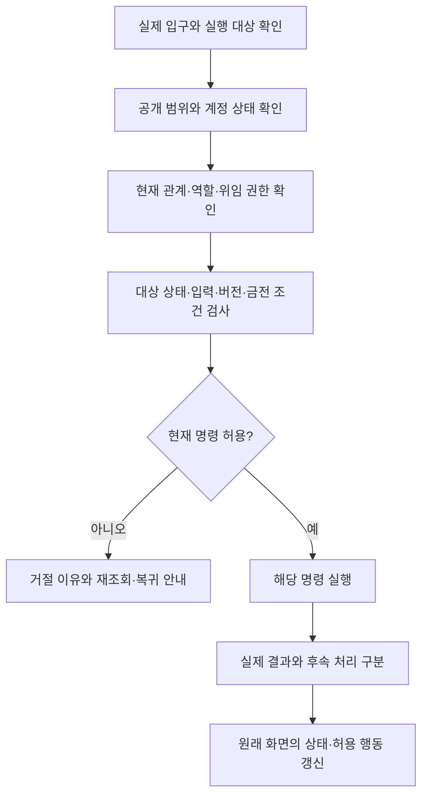

# 권한 정책 PRD

<!-- release-document: reference -->
> 2026-11-22 현재 기능 정본과 추가 관리자·공개 범위 소스를 대조했다. 역할 설명, 현재 실행 자격, 공개 설정, 실제 검증 결과를 구분한다. 현재 작업 순서는 [앞으로 할 일](../../../docs/plan/NEXT_WORK.md)을 따른다.

## 권한을 판정하는 단위

권한은 역할 이름 하나가 아니라 **현재 계정 + 대상과의 관계 + 위임 권한 + 대상 상태 + 공개 범위 + 해당 명령의 조건**으로 판단한다. 조회·수정·확정·취소·후속 반환은 같은 대상에서도 조건이 다르다. 메뉴 노출이나 서버 응답에 있는 행동 허용값은 다음 명령의 최종 권한 검사를 대체하지 않는다.

| 구분 | 서로 분리해서 확인할 것 |
|---|---|
| 비로그인·로그인 | 공개 HTTP 경로인지, 서비스 내부의 익명 분기만 있는지, 제한 계정의 허용 경로인지 |
| 신청자·결제 대기자·참석자·대기자 | 신청 승인과 실제 참석 행, 게스트의 책임 회원, 본인 취소·납부·체크인 자격 |
| 호스트·공동호스트 | 현재 주최자와 유효한 위임, 출석·공지·메시지·환불·분쟁 등 개별 권한 |
| 클럽 회원·운영진·소유자 | 회원 자격, 유효한 운영 권한, 소유자 전용 명령, 역할 제한과 위임 가능 범위 |
| 작성자·구매자·금전 당사자 | 초안 소유권, 현재 구매 권리, 원 납부자·부담자, 지금 관리하는 사람과의 차이 |
| 신고·분쟁 당사자·처리자 | 사건 접근, 자료별 열람, 자기 대상 제한, 호스트 답변과 플랫폼 판단 |
| 플랫폼 관리자 | 관리자 인증·작업별 권한·민감 명령 재인증·별도 운영 관문. 클럽 운영 권한과 같은 계정 역할이 아님 |

이 표는 독자의 역할 구분을 돕는 목록이며 서버 enum 전체나 모든 기능의 허용표가 아니다. 기능별 현재 조건은 연결한 정본을 따른다.

## 실행 전 검사와 화면 복귀

서버가 제공하는 abilities·actions를 쓰는 화면은 그 응답과 현재 계정·대상을 함께 확인한다. 기능마다 남은 화면·서버 차이는 정본의 제한 표에 남기며, 모든 화면이 권한을 같은 방식으로 계산한다는 전역 완료 선언을 하지 않는다. 권한 정보가 아직 없거나 오류인 상태와 명시적인 거절 상태도 나눠 안내한다.

화면을 연 뒤 역할이 회수되거나 소유자가 바뀔 수 있다. 확인창의 옛 값, 다른 계정의 늦은 응답, 다른 모임에 속한 하위 번호로 명령을 계속하지 않도록 검토한다. 성공 응답 뒤 재조회 실패는 명령 자체의 실패와 다르며, 결과 불명에서는 임의로 성공·취소를 확정하지 않는다.

## 출시 범위와 안전 출구

기능 공개 관문과 사용자 권한은 별개다. 공개 설정에 없으면 새 업무가 제한될 수 있지만, 안전 출구로 지정된 기존 건의 종료·반환·차단 등은 해당 공개 관문을 통과한다. 안전 출구가 본인·사건·상태 검사를 생략하는 것은 아니다. 메서드의 공개 범위 지정이 클래스 지정보다 우선한다.

공통 관문은 기본 묶음 P0를 허용하고 명시 목록을 해석한다. 설정 자체가 생략된 관문의 대체값은 운영 환경에서 P0, 비운영 환경에서 기본 허용 묶음이며 `MEETING_PREPAYMENT`는 비운영에서도 명시해야 열린다. 하위 묶음은 상위 묶음도 열려 있어야 한다. 모르는 서버 설정 이름은 조용히 무시하지 않고 설정 오류로 처리한다.

이 설명은 소스의 설정 해석 규칙이다. 저장소 설정 파일의 기본 목록·환경 변수·실제 배포 응답을 같은 것으로 간주하지 않으며 이 문서에서 운영 중인 공개 목록을 조회한 것은 아니다. 신규 참가비 수단과 기존 납부 건의 확인·반환은 [이벤트 참가비 선입금·은행 확인·환불 기록](../02_feature_prds/03_event/F03-13_event-prepayment_prd.md), 돈 기능의 별도 조건은 [결제·정산 정책](payment_settlement_policy_prd.md)을 함께 따른다.

## 이벤트의 변경·참석·출석 권한

| 행동 | 현재 권한과 구분 |
|---|---|
| 일반 수정·공개·종료·취소·삭제 | 호스트 또는 유효한 공동호스트를 확인하고 각각의 상태·유형 조건 적용. 공지의 추가 발송 권한과 반복 일괄 관리의 원본 호스트 조건은 별도 |
| 신청·직접 참석 | 본인 신청 조건과 실제 참석 조건을 분리. 호스트 본인·제한 계정·클럽 자격·현재 모집·결제 조건을 검사 |
| 정원 설정 | 호스트·활성 공동호스트·클럽 관리자. 저장은 일반 모임의 DRAFT·OPEN 조건 적용 |
| 대기 명단 조회·승격 | 전체 조회·본인 일행 조회·수동 승격의 권한을 분리. 명단을 볼 수 있다고 승격할 수 있는 것은 아님 |
| 모집 마감·재개 | 모임을 연 호스트 본인. 정기모임 회차는 별도 경로 |
| 참가자 제거 | 공개 경로의 호스트·활성 공동호스트 조건에 이어 출석 관리·결제 조건 적용. 클럽 출석 권한만으로 항상 제거 가능하다고 쓰지 않음 |
| QR·코드 발급·직접 체크인 | 출석 관리자가 발급·직접 체크인을 수행. 참석자는 자신의 계정으로 스캔·코드 입력. 대기·승인 신청만으로 실제 참석 자격을 대체하지 않음 |

공동호스트는 존재 여부와 현재 유효 여부를 구분한다. 출석·메시지·공지·환불·분쟁 위임 플래그는 각 명령에서 필요한 것을 검사한다. 공통 호스트 판정 함수의 목록이나 능력 플래그 수를 고정해 모든 창구에 같은 허용 범위를 적용하지 않는다.

자세한 입구·실패·복귀는 [이벤트 수정·공개·종료·취소](../02_feature_prds/03_event/F03-04_event-lifecycle_prd.md), [이벤트 신청·참석·본인 취소](../02_feature_prds/03_event/F03-05_event-attendance_prd.md), [정원 설정·대기열·모집 관리](../02_feature_prds/03_event/F03-07_capacity-and-waitlist_prd.md), [QR·코드·직접 체크인](../02_feature_prds/03_event/F03-08_qr-checkin_prd.md)을 따른다.

## 참가비와 모임 정산의 권한

참가비는 본인 신청의 결제 대기·기한·현재 수단·계정과 모임 상태를 검사한다. 자동 승인으로 결제 대기가 된 경우도 있으므로 ‘호스트가 수동 승인한 뒤에만’으로 좁히지 않는다. 앱은 지갑뿐 아니라 은행 안내·신고·확인 결과 입구도 제공한다. 은행 신고는 송금 실행이나 참석 확정이 아니며, 입금 안내의 계좌 원문과 일반 결제 이력의 마스킹 범위를 구분한다.

정산의 현재 주최자·정산 생성자·실제 참석자·분담 및 송금 당사자는 서로 다를 수 있다. 앱 관리 입구의 현재 주최자 조건과 서버 변경의 생성자 조건을 동일하다고 단정하지 않는다. 초안의 비관리자 응답은 메모·타인 상세·항목·영수증을 제한하며, 본인 행과 합계를 받는 경우도 전체 상세 열람 권한과 구분한다.

정산 요청은 생성자 권한·해당 초안·모임 종료·항목·분담을 검사한다. 요청 결과가 바로 완료일 수도 있고 요청 자체가 돈 납부는 아니다. 일반 은행 송금은 받는 사람 또는 생성자의 입금 확인을 사용하되 생성자도 본인이 보낸 돈을 스스로 확인할 수 없다. 이의 접수·생성자 답변·운영팀 판단·후속 금액 변경은 별도 명령이다.

[모임 정산](../01_domain_prds/07_모임_정산_prd.md), [금액 검토·정산 요청·취소와 반환](../02_feature_prds/07_meeting_settlement/F07-03_activate-cancel_prd.md), [정산 이의와 변경 기록](../02_feature_prds/07_meeting_settlement/F07-08_appeal-audit_prd.md)을 따른다. 위 권한으로 모든 출금·강제환불·운영자 보정을 실행할 수 있다고 확대하지 않는다.

## 이동 조율의 현재 경계

현재 앱은 이동 조율 경로를 사용한다. 현황은 호스트·활성 공동호스트 또는 실제 참석 행이 있는 회원이 조회하며, 대기자·승인 신청만 있는 사용자는 그 사실만으로 접근할 수 없다. 설정 저장은 호스트·활성 공동호스트와 DRAFT·OPEN을 요구한다. 현재 설정을 끌 때 기존 배정과 기록은 유지된다.

차량별 배정과 물리 좌석을 분리한다. 주최자의 배정·재배정은 차량 정책에 따른 일반 참가자의 직접 선택과 다르다. 아직 배정되지 않은 본인의 첫 자리 잡기는 목적 차량이 SELF_CLAIMS이면 가능하며, 이미 배정된 본인의 이동·자리 비우기는 모임의 본인 변경 허용 등 추가 조건을 검사한다. ‘처음 배정은 언제나 호스트’ 또는 ‘자리를 반납할 수 없음’을 공통 권한으로 쓰지 않는다.

옛 카풀·버스 endpoint 표와 2026년 9월의 통합 차량 표를 현재 이동 조율 계약으로 재사용하지 않는다. [이동수단 공통 설정](../02_feature_prds/03_event/F03-14_event-transport-mode_prd.md), [대절 버스와 자리 배정](../02_feature_prds/03_event/F03-16_event-bus-charter_prd.md)을 따른다.

## 클럽 회원·역할·권한 위임

| 행동 | 현재 경계 |
|---|---|
| 회원 명단 | 현재 회원 자격과 조회 목적을 확인. 일반 탐색의 사람 차단 필터와 운영 대상 선택의 별도 권한은 다름 |
| 기본정보 수정 | 현재 소유자 또는 유효한 운영진 권한. 역할 문자열만으로 실행을 확정하지 않음 |
| 역할 변경·세부 권한 위임 | 현재 소유자 전용. 역할 변경 API로 OWNER를 바꾸지 않으며 소유권 이전은 별도 절차 |
| 강퇴·차단 | 현재 운영 권한·대상 보호 적용. OWNER는 대상이 될 수 없고 ADMIN 대상은 소유자만 처리. 강퇴와 재가입 차단은 다른 명령 |
| 일반 회원으로 강등 | 저장된 위임 비트도 회수 |
| 폐쇄·소유권 이전 | 소유자 자격 외에 책임·미결 돈·현재 버전·재인증 등의 해당 절차 적용 |

위임 가능 목록 밖 비트는 거절하며 POLICY_OWNER는 소유자 전용, STAMP_ISSUER는 운영진의 자동 효과로 일반 위임 대상이 아니다. ‘모르는 비트는 모두 되돌려 보내 보존한다’는 옛 설명을 서버의 허용 마스크 검사보다 우선하지 않는다.

[회원 목록·역할·권한 위임과 강퇴](../02_feature_prds/04_club/F04-04_member-management_prd.md), [클럽 생성·수정·폐쇄와 소유권 이전](../02_feature_prds/04_club/F04-03_club-crud-transfer_prd.md)을 따른다. API 경로에 admin이 있다는 이유만으로 플랫폼 관리자용 기능이라고 분류하지 않는다.

## 역할 제한이 적용되는 권한

역할 제한은 클럽의 운영진 유효 권한과 그 클럽 모임의 공동호스트 위임 권한에 적용한다. 저장된 ADMIN 또는 공동호스트 행이 남아 있어도 현재 권한을 통과한다는 뜻이 아니다. 제한 중 새 운영진 승격과 새 위임 권한 부여도 거절한다.

역할 제한을 일반 회원 자격 박탈·참가 제한·강제 탈퇴와 혼동하지 않는다. 소유자는 이 제재의 대상 보호를 받고, 직접 주최한 모임의 호스트 권한과 공동호스트 위임 권한도 다르게 판정한다. 기록을 지워 버리는 대신 현재 효력을 검사하므로 만료·철회 뒤에는 당시의 역할·위임 자격으로 다시 판단한다.

검토자는 WARNING_REVIEWER, 일반 제재 집행은 SANCTION_PROPOSER로 구분하고 강제 탈퇴의 집행·재시도·철회에는 OWNER 조건을 추가한다. 같은 사람이 여러 권한을 가질 수 있어도 검토 권한 하나로 모든 집행을 허용하지 않는다. [클럽 경고 제보 심사](../02_feature_prds/15_warning/F15-05_report-review_prd.md), [클럽·플랫폼 제재와 계정 제한](../02_feature_prds/15_warning/F15-08_sanction-enforcement_prd.md)을 따른다.

## 마일리지·스탬프·투표 운영

| 업무 | 현재 권한과 추가 조건 |
|---|---|
| 마일리지 제도 설정·변경 미리보기 | POLICY_OWNER와 해당 공개 범위 |
| 점수 적립·차감·원장 정정 | REWARD_MANAGER. 새 지급·차감과 정정의 제도 상태 조건은 다름 |
| 배지 부여·회수 | BADGE_AWARD_MANAGER. 점수 명령과 같은 요청 키 계약이라고 추정하지 않음 |
| 검토 대기열·대시보드·감사 조회 | MILEAGE_MANAGER. 반복 적립 부정 판정에는 REWARD_MANAGER도 필요 |
| 스탬프 생성·공동 운영 | 현재 클럽장·운영진, 만들기 허용 설정, 발행자 잠금·이관 조건을 함께 적용 |
| 게시글 투표 | 글 작성자·유효 운영진의 관리와 회원의 열람·투표 조건을 구분. 예약 글은 별도 제한 |
| 모임 참가자 투표 | 주최 측의 생성·관리와 실제 참석자의 투표권은 별개 |
| 일정·장소 결정 투표 | 관리 권한·현재 클럽 회원·초안 열람·주최자 투표 제외 조건을 각각 적용 |

[마일리지 제도 설정](../02_feature_prds/16_mileage/F16-04_policy-config_prd.md), [적립·차감·정정·배지 집행](../02_feature_prds/16_mileage/F16-06_grant-redeem-reverse_prd.md), [검토 대기열·대시보드·감사 기록](../02_feature_prds/16_mileage/F16-08_review-queue-dashboard_prd.md), [클럽 스탬프의 누가 무엇을 할 수 있는가](../../docs/features/club-stamp.html#stamp-permissions), [클럽 투표의 어떤 투표를 쓰는가](../../docs/features/club-poll.html#poll-types)를 따른다. 클럽장도 다른 발행자가 잠근 스탬프 판을 임의 변경할 수 없으며 자격을 잃은 발행자의 이관 조건은 별도다.

## 소유권 변경과 남은 책임

클럽 소유권 제안은 즉시 역할 변경이 아니다. 양 당사자의 확인·재인증과 현재 책임 내용·버전을 확인해 수락해야 효력이 발생한다. 진행 중 출금·미정산·같은 통화 기금으로 상계한 뒤 남는 미수금은 수락을 막는다. 책임 요약에 신고·제재가 있다는 사실만으로 같은 금전 보류 조건이라고 쓰지 않는다.

정기모임 본체와 각 회차의 호스트를 구분한다. 관리자 변경 경로의 운영 관문을 통과하더라도 이전 제약이 없는 현재 호스트의 회차만 넘기며, 제약이 있는 회차는 이전 책임자에게 남긴다. 새 코스 호스트의 명령이 남겨진 회차의 취소·출석 확정까지 임의로 허용하지 않는다.

제공자 거래의 권한은 현재 호스트·공동호스트를 기준으로 판정하지만 반환의 원천은 실제 납부자와 기록된 회수 대상에 남는다. 새 호스트에게 과거 대납 반환을 임의로 돌리지 않는다. 새로 실행하는 호스트 부담 부분환불은 실행 시점의 호스트 지갑을 쓰는 별도 경우다. [정기모임 공개·종료·취소·호스트 변경](../02_feature_prds/17_regular_meeting/F17-04_regular-meeting-lifecycle_prd.md), [제공자 이용료 환불·정산 후 회수·배정 종료](../02_feature_prds/21_curated/F21-05_refund-clawback_prd.md)를 따른다.

## 플랜·데이팅·위치·민감 자료

플랜 기본 정보·견본·전체 본문은 별도 조회다. 현재 HTTP 플랜 경로는 로그인을 요구한다. 초안은 작성자, 유료 전체 본문은 작성자 또는 유효 구매 권리, 공개 무료 본문은 무료 조건을 적용한다. 숨김의 유효 구매자는 계속 읽을 수 있지만 삭제는 작성자를 포함해 찾을 수 없다. 무료 읽기가 이벤트 생성 권리까지 부여하는 것은 아니다. [플랜 상세·미리보기와 관리 행동](../02_feature_prds/08_plan_market/F08-02_plan-detail_prd.md)을 따른다.

데이팅의 본인확인·프로필 활성·공개 범위·매치·차단·공개 설정은 서로 다른 조건이다. 위치는 동의를 켜는 역할·좌표를 쓰는 역할·다른 사람 좌표를 읽는 역할을 나눈다. 분쟁은 사건에 접근할 권한을 먼저 확인한 뒤 증빙 가시성과 제출자 예외를 적용한다. PUBLIC_SUMMARY를 비회원 공개로, CS_ONLY를 모든 경로에서 제출자도 못 보는 자료로 일반화하지 않는다.

정지·차단 계정도 지정된 고객지원·본인 분쟁·개인정보 권리 경로를 이용할 수 있다. 제한 경로를 통과해도 본인·원천 사건 권한은 유지된다. 세부 열람·차단·보존 경계는 [개인정보·안전 정책](privacy_safety_policy_prd.md), 제한 세션은 [클럽·플랫폼 제재와 계정 제한](../02_feature_prds/15_warning/F15-08_sanction-enforcement_prd.md)을 따른다.

소셜 로그인은 활성 제공자와 검증된 신원·대상 앱을 확인하고, 같은 이메일만으로 기존 계정에 자동 병합하지 않는다. 과거 특정 제공자의 설정 누락 시 경고 후 진행 설명을 현재 Google 로그인에 적용하지 않는다. [소셜 로그인](../02_feature_prds/01_auth_onboarding/F01-02_social-login_prd.md)을 따른다.

## 운영자 처리 사실과 회원 정보

정산 이의의 호스트 답변과 운영팀 판단은 다른 기록이다. 회원에게 운영팀 판단 글·시각을 제공하더라도 내부 관리자 번호는 주지 않는다. 정산 변경 기록의 ADMIN·SYSTEM 표시와 지정된 내부 키 제거도 응답별 규칙이며 모든 개인정보를 자동 탐지하는 기능이라고 설명하지 않는다.

운영 문의의 sourceId는 출처별 실제 행을 가리킨다. PAYMENT·REFUND 원천에 이벤트 결제 번호를 임의로 넣거나 정기모임 정산 원천에 모임 번호를 대신 넣지 않는다. 소유권과 연결 호스트도 그 원천으로 확인한다. [정산 이의와 변경 기록](../02_feature_prds/07_meeting_settlement/F07-08_appeal-audit_prd.md), [운영 문의](../02_feature_prds/20_support/F20-02_operational-issue_prd.md)를 따른다.

## 플랫폼 관리자 작업의 관문

클럽 내부 판단에 대한 플랫폼 강제 개입은 별도 설정을 사용한다. 관리자 긴급 소유권 승계와 정기모임 호스트 변경은 이 설정을 먼저 검사하며 기본값은 꺼짐이다. 꺼져 있으면 410으로 거절한다. 코드가 존재한다는 이유로 지금 모든 관리자에게 열렸다고 안내하거나, 반대로 코드 경로가 없다고 쓰지 않는다. 실제 배포 설정은 이번 문서에서 조회하지 않았다.

관리 명령은 해당 작업의 직무 권한과 요청 식별·현재 상태 조건을 적용한다. 개최권 환불의 원결제 초과 등 집행되지 않은 확정 거절과 결과 불명·명령 충돌을 구분한다. 현재 화면은 확정 거절에서 요청 키를 놓아 조건 정정 뒤 새 명령을 만들 수 있게 하지만, 결과 불명 명령과 충돌에서는 키를 보존한다. ‘모든 실패는 새 키’ 또는 ‘모든 거절은 영원히 같은 키’로 설명하지 않는다.

관리자 신규 계정·새 비밀번호 설정의 공통 검사는 12개 이상 문자 코드 포인트, UTF-8 72바이트 이하와 대문자·소문자·지정 특수문자를 요구한다. 기존 비밀번호 로그인과 새 비밀번호 설정 검증을 같은 단계로 합치지 않는다. 과거 차수별 화면 정리 기록은 현재 작업 권한의 전체 목록이 아니다.

## 관리자 로그인과 민감 작업의 재인증

일반 경로는 비밀번호 확인 뒤 5분 동안 유효한 두 번째 단계 대기를 만들고, 인증 앱 등록 또는 인증을 마쳐야 관리자 세션을 발급한다. 복구 코드는 한 번 소비하며 인증 코드의 이미 사용한 시간 단계도 다시 받아들이지 않는다. 최종 세션 발급 때 현재 비밀번호 지문과 인증 수단 세대·현재 계정 권한을 확인하므로 비밀번호 변경 전의 대기를 그대로 완료할 수 없다.

다만 특정 관리자에게 적용하는 2단계 인증 중지 설정이 있다. 지정한 종료 시각 전 또는 수동 해제 방식의 유효 설정은 비밀번호만으로 완료하는 경로를 허용한다. 같은 예외는 민감 작업의 재인증 관문에도 적용된다. 이 예외의 존재와 실제 운영 환경에서 켜져 있는지는 별개이며 현재 운영값을 확인하지 않았다.

민감 작업은 HTTP method와 실제 handler 경로의 지정 목록으로 판정한다. 금전 정정·권한 변경·개인정보 내보내기의 해당 경로에는 현재 관리자·세션에 묶인 5분 미만의 재인증을 요구한다. 일반 조회·메모·모든 상태 변경을 일괄 포함하지 않는다. 재인증에는 현재 유효한 인증 코드를 사용하며 같은 코드 재사용으로 시간을 계속 늘리지 못한다.

관리자 세션과 로그인 대기는 HttpOnly·SameSite=Strict 쿠키를 사용하고 Secure 설정 기본값은 true다. CSRF용 쿠키는 브라우저가 읽을 수 있는 별도 값이며 세션 쿠키와 혼동하지 않는다. 상태 변경 요청의 Origin이 있으면 허용 목록을 검사한다. 로그인 POST는 CSRF 검사 예외이고 그 밖의 CSRF 처리와 출처 검사를 구분한다. 이 소스 대조는 실제 운영 쿠키·두 창의 충돌·배포 리허설 통과 기록이 아니다.

## 권한 검토와 수용 기준

- **입구와 대상:** 실제 메뉴·목록·알림·공유 경로, 현재 계정, 부모와 하위 기록의 소속을 확인한다.
- **역할과 상태:** 신청·참석, 현재 호스트·정산 생성자, 소유자·운영진·위임 권한, 공개 설정·제재 효력을 나눈다.
- **실행 경계:** 실행 전 현재 상태·권한을 검사하고 조회 허용을 수정 허용으로 확장하지 않는다.
- **실패와 복귀:** 권한 없음·조회 실패·버전 충돌·결과 불명·후속 처리 대기를 구분하며 현재 상태를 다시 확인한다.
- **증거:** 이번 내용 대조와 과거 감사·기존 시험·새 실행·배포 공개를 구분한다. 판정 방법은 [기획 QA 정책](planning_qa_policy.md)을 따른다.

## 과거 권한 조사 원문 보존

아래는 이전 문서의 날짜별 조사·감사·시험 기록 원문이다. 당시 코드 위치·옛 창구·권한 공백·시험 통과 수를 현재 계약이나 이번 실행 증거로 다시 사용하지 않는다. 현재 설명은 위 본문과 연결한 기능 정본이 우선한다.

> ## 이벤트 선입금·교통 endpoint 권한 매트릭스 (2026-07-29 현재 소스)
>
> > 현재 근거는 각 Controller/Service와 전역 Security 설정이다. 삭제된 event-extensions 계획은 현재 권한 계약이 아니다. 공통 권한 빈의 실제 경로는 `community_api/src/main/java/com/endside/community/event/service/EventAuthorizationService.java`다.
>
> ### EventAuthorizationService 실제 공개 메서드
>
> | 메서드 | 의미 | 호출자 |
> |---|---|---|
> | `assertHost(Event, userId)` | 주 호스트만 통과 | 일부 event 운영 서비스 |
> | `assertHostOrCoHost(Event, userId)` | 주 호스트 또는 공동호스트만 통과 | transport/carpool/bus/prepayment host endpoint |
>
> `assertMemberSelf`, `assertAttendingOrApproved`, eventId overload는 존재하지 않는다. 참가자 본인·참석 상태는 각 도메인 서비스가 application/attendance row를 직접 검증한다.
>
> ### W1 — 정원 초과 허용
>
> | Endpoint | Method | 허용 역할 | 빈 호출 | 비고 |
> |---|---|---|---|---|
> | `/events/{id}/capacity-settings` | PATCH | HOST, COHOST | `assertHostOrCoHost` | DRAFT + OPEN 상태에서 호출 가능 (Q7). baseCapacity, overcapacityAllowed, hardCapacityLimit 갱신. |
>
> ### W2~W3 — 참가 선입금
>
> | Endpoint | Method | 허용 역할 | 빈 호출 | 비고 |
> |---|---|---|---|---|
> | `/events/{id}/prepayment/wallet` | POST | 해당 application의 사용자 | service의 application user 일치 검증 | APPROVED_PENDING_PAYMENT에서 WALLET 즉시 차감 + APPROVED/ATTENDING 전이 |
> | `/events/{id}/prepayment/bank-declare` | POST | 해당 application의 사용자 | service의 application user 일치 검증 | BANK_TRANSFER PENDING 생성. 72는 이벤트 주 호스트 한 명에게만 전송 |
> | `/events/{id}/applications/{appId}/bank-confirm` | POST | HOST, COHOST | `assertHostOrCoHost` | 호스트가 입금 확인. event_payment.status=PAID → application ATTENDING. 73 알림. |
> | `/events/{id}/applications/{appId}/bank-reject` | POST | HOST, COHOST | `assertHostOrCoHost` | 호스트가 입금 미확인 처리. 74 알림. |
> | `/events/{id}/applications/{appId}/refund-wallet` | POST | 결제 사용자 또는 HOST/COHOST | participant-or-host 분기 | 정책 카탈로그 기반 WALLET 환불 |
> | `/events/{id}/applications/{appId}/refund-bank-confirm` | POST | HOST/COHOST 또는 club OWNER/`EVENT_REFUND_MANAGER` | refund manager 분기 | 외부 BANK 환불 완료 표시, 증빙 최대 5건 |
>
> `POST /prepayment/cancel`, `GET /host/payments` endpoint는 없다. 참가 취소는 `DELETE /api/v1/events/{eventId}/apply` facade를 따른다. 운영자 강제환불은 인증 public API가 아니라 `X-Internal-Token`으로 보호된 `POST /api/internal/event-payments/{paymentId}/force-refund`를 admin API가 호출한다.
>
> 환불 정책 조회도 전역 `anyRequest().authenticated()` 대상이다. `GET /api/v1/refund-policy-templates`는 permitAll이 아니다. 다만 다음 authorization Gap이 있다.
>
> - `POST .../refund-preview`: Controller가 actor를 log만 하고 service에 전달하지 않아 applicationId 기반 IDOR 후보
> - `GET .../no-show-refund`: principal이 없고 path eventId도 service에서 무시해 actor authorization/event scoping 누락
>
> ### 2026-09-02 현재 — 통합 이동수단 권한
>
> 종전 카풀·버스별 권한은 통합 차량 경로로 교체됐다. 현재 권한은 아래처럼 판단한다.
>
> | 업무 | 허용 주체 | 서버 방어 |
> | --- | --- | --- |
> | 이동 설정 조회 | 인증 사용자 | 출시 범위가 닫히면 차단. 민감한 탑승자 정보는 포함하지 않음 |
> | 이동 설정 변경 | 호스트·공동 호스트 | 이벤트 행을 잠그고 권한 재확인. 살아 있는 차량이 있으면 운영 종료 거절 |
> | 차량 목록·자리 조회 | 호스트·공동 호스트, 참석 확정자, 대기자 | 역할을 먼저 확인하고 일반 참가자에게 타인의 식별자·이름을 숨김 |
> | 대절 버스 등록 | 호스트·공동 호스트 | 열린 모임·이동 운영·활성 배치도 또는 유효 정원을 검사 |
> | 승용차·자차 등록 | 참석 확정자 본인 | 차량 주인은 인증 사용자로 고정. 자차 허용·중복 차량·정원을 검사 |
> | 승용차 승인·거절 | 호스트·공동 호스트 | 대기 상태와 화면이 본 버전을 함께 확인 |
> | 자리 배정·이동 | 호스트·공동 호스트 또는 자기 선택 차량의 참석자 본인 | 참석 자격·빈자리·차단 관계·차량 상태·다른 차량 중복 탑승을 확인 |
> | 자리 반납 | 호스트·공동 호스트 또는 허용된 참가자 본인 | 참가자는 자기 자리·자기 선택 차량·자리 반납 허용을 모두 충족해야 함 |
> | 운행 취소·자차 종료·이동 조율 이탈 | 해당 차량 주인 또는 호스트 명령 | 신규 점유를 만들지 않는 안전 출구라 출시 봉인 중에도 허용 |
> | 자리·차량 신고 | 참석 확정자 | 대상 사용자를 본문에서 받지 않고 서버가 자리 점유자·차량 주인으로 확정 |
> | 차량 배치도 운영 | `MANAGE_EVENT` 플랫폼 운영자 | 조회는 읽기 권한, 생성·수정·활성화는 쓰기 권한. 빈 좌석표와 사용 중 변경 차단 |
>
> 관련 권한·경합 회귀는 `EventVehicleServiceTest`, `EventVehicleSeatFlowDataJpaTest`,
> `EventVehicleReportServiceTest`, `ManageVehicleLayoutGuardTest`, 앱의 이동수단 접근 테스트에서 확인한다.
> 2026-09-02 표적 회귀는 사용자 API 156건·앱 160건·관리자 API 23건·관리자 웹 E2E 3건 실패 0이다.
>
> ### 2026-07-29 이력 — W4 교통 모드 베이스
>
> > 아래 W4~W7 표와 당시 권한 공백은 통합 전 소스를 기록한 이력이다. 현재 권한 판단에는 바로 위
> > “2026-09-02 현재 — 통합 이동수단 권한”과 F03-14~17 기능 PRD를 사용한다.
>
> | Endpoint | Method | 허용 역할 | 빈 호출 | 비고 |
> |---|---|---|---|---|
> | `/events/{id}/transport` | GET | Authenticated | 전역 Security만 | event 존재·참가 자격 service gate 없음 |
> | `/events/{id}/transport/config` | PUT | HOST, COHOST | `assertHostOrCoHost` | mode 변경은 DRAFT only hard delete. `allowsSelfTransport` 단독 변경에는 status gate 없음 |
>
> ### W5 — 카풀 운영
>
> | Endpoint | Method | 허용 역할 | 빈 호출 | 비고 |
> |---|---|---|---|---|
> | `/events/{id}/carpool/offers` | GET | HOST/COHOST 또는 ATTENDING | service 직접 검사 | full offer 목록과 driver/location 노출 |
> | `/events/{id}/carpool/passengers` | GET | HOST/COHOST=전체, 그 외 인증 사용자=본인 row/빈 목록 | service 분기 | 일반 사용자에는 별도 ATTENDING 검사 없음 |
> | `/events/{id}/carpool/offer` | POST | ATTENDING | attendance 직접 검사 | OPEN + CARPOOL mode, 이벤트당 운전자 1건 |
> | `/events/{id}/carpool/offers/{oid}/decision` | POST | HOST/COHOST | `assertHostOrCoHost` | CONFIRMED/REJECTED만 허용. 77/78 생산 알림은 없음 |
> | `/events/{id}/carpool/offers/{oid}/report` | POST | 운전자가 아닌 ATTENDING | attendance·eventId 직접 검사 | mode/status 가드 없이 공통 ReportService 위임 |
> | `/events/{id}/carpool/passenger` | PUT | ATTENDING | attendance 직접 검사 | CARPOOL mode, 사용자 row upsert |
> | `/events/{id}/carpool/passengers/{pid}/assignment` | PUT | HOST/COHOST | `assertHostOrCoHost` | `offerId` null이면 해제. event lock/정원 검사. assignment log·79/80 알림은 없음 |
>
> ### W6 — 차량 레이아웃 카탈로그
>
> | Endpoint | Method | 허용 역할 | 빈 호출 | 비고 |
> |---|---|---|---|---|
> | `/vehicle-layouts/active` | GET | Authenticated | (인증만) | 호스트가 버스 생성 시 활성 레이아웃 read-only 조회. |
> | `/vehicle-layouts/{id}/seats` | GET | Authenticated | (인증만) | inactive layout도 조회, 없는 ID는 빈 목록 |
> | `/admin/v1/manage/vehicle-layouts` | GET/POST | `MANAGE_EVENT` Admin | principal privilege 검사 | 목록/생성 |
> | `/admin/v1/manage/vehicle-layouts/{id}` | GET/PUT | `MANAGE_EVENT` Admin | principal privilege 검사 | 상세/메타 수정. DELETE 없음 |
> | `/admin/v1/manage/vehicle-layouts/{id}/seats` | POST | `MANAGE_EVENT` Admin | principal privilege 검사 | 좌석맵 전체 교체 |
> | `/admin/v1/manage/vehicle-layouts/{id}/active` | PATCH | `MANAGE_EVENT` Admin | principal privilege 검사 | active 토글 |
>
> ### W7 — 이벤트 측 버스 운영
>
> | Endpoint | Method | 허용 역할 | 빈 호출 | 비고 |
> |---|---|---|---|---|
> | `/events/{id}/buses` | GET | Authenticated | 전역 Security만 | event 존재·역할 service gate 없음 |
> | `/events/{id}/buses` | POST | HOST, COHOST | `assertHostOrCoHost` | 버스 인스턴스 생성 (vehicle_layout 참조). |
> | `/events/{id}/buses/{bid}/seats` | GET | HOST/COHOST 또는 ATTENDING/WAITING | service 직접 검사 | 일반 사용자는 타인 `userId`만 null 마스킹 |
> | `/events/{id}/buses/{bid}/seats/{seatNo}?userId=` | PUT | HOST/COHOST, 또는 `allowSelfSwap=true && userId=actor` | service 분기 | assignmentMode·참석 자격·lockedByHost 미검사. 진짜 swap/unassign·FIRST_COME 자동배정·81/82 알림 없음 |
>
> 버스 메타 PUT/DELETE endpoint는 없다.
>
> ### 이벤트 권한 매트릭스 확장 (요약)
>
> | 액션 | 게스트 | 로그인 사용자 | 신청자 | 참석자 | 대기자 | 호스트 |
> |---|:-:|:-:|:-:|:-:|:-:|:-:|
> | 정원 설정 변경 |  |  |  |  |  | O |
> | 참가 선입금 결제 (WALLET) |  |  | 조건부(승인 후) |  |  |  |
> | 계좌이체 입금 신고 |  |  | 조건부(승인 후) |  |  |  |
> | 계좌이체 확인/거절 |  |  |  |  |  | O |
> | 교통 모드 설정 |  |  |  |  |  | O |
> | 카풀 offer 등록 |  |  |  | O | (대기는 보통 제외) |  |
> | 카풀 offer 확정/거절 |  |  |  |  |  | O |
> | 카풀 탑승자 배정 |  |  |  |  |  | O |
> | 버스 인스턴스 생성 |  |  |  |  |  | O |
> | 버스 좌석 조회 |  |  |  | O | O | O |
> | 버스 좌석 user 지정 |  | 조건부 self |  | 조건부 self | 조건부 self | O |
>
> 조건부 항목:
> - 참가 선입금 결제는 `application.status = APPROVED_PENDING_PAYMENT`일 때만 허용. 승인 전/거절 후/만료 후/이미 결제 완료 상태에서는 차단.
> - 카풀 offer는 `EventAttendance.status=ATTENDING`이어야 한다. `APPROVED_PENDING_PAYMENT`만으로는 허용되지 않는다.
> - non-host 버스 좌석 지정은 `allowSelfSwap=true`와 `userId=actor`만 검사한다. assignment mode·ATTENDING/WAITING·lockedByHost는 현재 PUT gate에 포함되지 않는다.
>
> ### 2026-07-29 당시 권한 공백 — 현재 판단에 사용하지 않음
>
> - transport GET과 bus list GET은 인증만 요구하며 event 존재·참가 관계를 service에서 확인하지 않는다.
> - bus self PUT은 참석 자격·assignment mode·locked seat 검사가 없다.
> - 카풀 passenger GET과 report는 다른 카풀 endpoint보다 mode/참석 gate가 느슨하다.
> - 카풀 결정·탑승선택·배정·신고와 버스 생성·좌석 지정에는 이벤트 상태 gate가 없어 CLOSED/CANCELED 이후에도 쓰기가 가능하다.
> - `allowsSelfTransport=false`를 카풀 SELF/DRIVER 선택과 대조하는 consumer가 없어 권한·정책 토글이 inert하다.
> - refund preview/no-show refund는 actor/eventId scoping이 빠진 IDOR 후보다.
> - 차량 레이아웃 admin API는 구현돼 있지만 전용 권한 회귀 테스트는 찾지 못했다.
>
> ## v5.0 delta 신규 권한 (2026-06-05)
>
> ### EventCoHost Permission Flag 5종 (Wave E-1)
>
> > 소스: `EventCoHost.java:38-55`, `EventCoHostController.java:31`
>
> 공동호스트는 이제 기능별 개별 권한 플래그를 부여받는다. PATCH `/api/v1/events/{eventId}/co-hosts/{coHostUserId}/permissions` (호스트만 호출 가능).
>
> | 플래그 | 컬럼 | 기본값 | 의미 |
> |---|---|---|---|
> | `canManageAttendance` | `can_manage_attendance` | false | 수동 체크인·참석자 강제 제거·대기열 수동 승급·노쇼 확정/뒤집기. `EventAttendanceManagerGuard`가 체크인과 노쇼에 같은 기준을 적용한다. |
> | `canModerateMessages` | `can_moderate_messages` | false | 타 사용자 이벤트 메시지 삭제(콘텐츠 모더레이션) |
> | `canSendAnnouncement` | `can_send_announcement` | **true** | 공지 일괄 발송 (기존 동작 보존 — 기본 true) |
> | `canHandleRefundIssue` | `can_handle_refund_issue` | false | 환불 처리(은행 환불 확인 등) |
> | `canResolveDispute` | `can_resolve_dispute` | false | 분쟁 처리 가능 여부 |
>
> 이벤트 권한 매트릭스 확장 (공동호스트):
>
> | 액션 | 호스트 | 공동호스트 (flag 충족 시) |
> |---|---|---|
> | 수동 체크인·참석자 제거 | O | `canManageAttendance=true` 시만 |
> | 메시지 삭제 모더레이션 | O | `canModerateMessages=true` 시만 |
> | 공지 일괄 발송 | O | 기본 허용 (`canSendAnnouncement` 기본 true) |
> | 환불 처리 | O | `canHandleRefundIssue=true` 시만 |
> | 분쟁 처리 | O | `canResolveDispute=true` 시만 |
>
> ### 분쟁 케이스 Visibility별 접근 권한
>
> > 소스: `Visibility.java`, `DisputeCaseDetailVo.ActorPermissionFlags`
>
> **정책 의도 (4종 분류)**
>
> | Visibility | 열람 가능 역할 (정책 목표) |
> |---|---|
> | `PARTIES` | 신고자(reporterUserId), 피신고자(targetUserId), 소유 호스트(ownerHostUserId) |
> | `HOST_ONLY` | 소유 호스트(ownerHostUserId), CS/운영팀 |
> | `CS_ONLY` | CS/운영팀만 (admin API 전용) |
> | `PUBLIC_SUMMARY` | 인증된 모든 사용자 (요약 정보만) |
>
> **현재 구현**: public detail 조회 시 CS_ONLY 항목 제거 필터만 적용. HOST_ONLY를 소유 호스트에게만 노출하거나 PARTIES를 당사자로 제한하는 역할별 분기 builder는 미구현(Gap — 향후 구현 필요).
>
> **ActorPermissionFlags** (서버가 케이스별로 내려주는 동적 권한 flag):
>
> | 플래그 | 의미 | 비고 |
> |---|---|---|
> | `canResolveDispute` | 분쟁 처리 권한 | 호스트/CS |
> | `canEscalateToCs` | CS 에스컬레이션 권한 | — |
> | `canSendNote` | 타임라인 노트 추가 | — |
> | `canModerateMessages` | 메시지 숨김/삭제 | — |
> | `canHandleRefundIssue` | 환불 처리 | — |
> | `canManageAttendance` | 노쇼 관리 | — |
> | `canApproveAppeal` | 이의 승인/거절 | **Gap**: 공개 API endpoint 없음. admin API 소유만. flag는 UI gating용이지만 호스트/공동호스트가 appeal을 UPHELD/REJECTED로 전이하는 공개 endpoint 미구현. |
>
> ### 노쇼 확정/뒤집기 권한
>
> > 2026-07-29 current source: `EventNoShowService`와 `CheckInService`가 `EventAttendanceManagerGuard`를 공유한다. 과거 cohost flag 미검사 Gap은 해소됐다.
>
> | 액션 | 권한 | 서버 가드 |
> |---|---|---|
> | 노쇼 확정(confirm, confirmBatch) | 호스트·`canManageAttendance=true` cohost·클럽 OWNER·`EVENT_ATTENDANCE_MANAGER` 보유자·`role.canCreateEvent()` fallback | flag 없는 cohost는 `EVENT_CO_HOST_PERMISSION_DENIED`, 그 외 무권한자는 `EVENT_NOT_OWNER` |
> | 노쇼 뒤집기(overturn) | 위와 동일, 내부 SYSTEM/CS actor(id=0)는 가드 우회 | 회원 뒤집기는 기존 체크인이 없을 때 `NOSHOW_OVERTURN` 정정 체크인 생성 |
> | 참가자 소명(appeal) | **party owner만** — 회원 row는 본인, 게스트 row는 예매 소유자 | canonical `EVENT_NO_SHOW:{noShowId}` + 확정 후 7일 이내 |
>
> ### 클럽 강퇴(kick)/차단(ban) 권한 + 사유코드 의무
>
> > 소스: `ClubController`, `ClubMemberPermissionController`
>
> | 액션 | 허용 역할 | 사유코드 |
> |---|---|---|
> | 멤버 강퇴(kick) | 관리자, 소유자 (자기 자신·소유자 보호) | **필수 — 별도 enum `ClubKickReasonCode`(5값), 누락 시 `CLUB_KICK_REASON_REQUIRED` 400** |
> | 멤버 차단(ban) | 관리자, 소유자 | **필수 — 별도 enum `ClubBanReasonCode`(7값), 누락 시 `CLUB_BAN_REASON_REQUIRED` 400** |
> | 강퇴/차단 이의제기 | **본인(강퇴/차단 당사자)만** | RS-002 P3-C: `CLUB_MEMBERSHIP_ACTION:{id}`로 분쟁 union 진입. 제3자 이의 생성 차단(`FORBIDDEN`, `DisputeAppealService.java:126`). |
>
> > 사유코드는 `ApplicationRejectReasonCode`와 무관한 별도 enum으로 구현 완료. `ClubKickReasonCode`/`ClubBanReasonCode` controller level 필수 강제 적용됨.
>
> ## v6.0 접근권한 감사 교정 (2026-07-02)
>
> > 2026-06-30~07-02 전수 감사(21개 도메인·4개 웨이브)에서 확정·교정한 사항. 상세 근거는 `docs/audit/access-control-2026-06-30/` 참조. 각 항목에 대응하는 도메인 PRD가 있는 경우 해당 도메인 PRD를 상세 계약의 최종 권위로 한다.
>
> ### (a) 이벤트 서버 능력플래그 — 클라 단일소스 소비
>
> 이벤트 도메인의 권한 판정 방식을 전환했다. 기존에는 클라이언트가 `myRole`, `coHostUserIds` 등 원자 데이터에서 권한 boolean을 각 화면마다 각자 재계산(ad-hoc)했다. 교정 후 서버가 **뷰어별 능력플래그 11종**(이벤트 관리, 편집, 출석관리, 공지발송, 참석자열람, 신청승인, 체크인, 메시지삭제, 환불처리, 분쟁처리, 정원관리)을 계산해 EventVo에 포함해 내려준다. 클라이언트는 이 플래그만 소비하고 로컬 재계산을 하지 않는다.
>
> 이 변경은 `ActorPermissionFlags`(분쟁 도메인의 골든 표준)를 이벤트로 확산한 것으로, 공동호스트 플래그 불일치·드리프트·과(過)노출 다수를 일관 해소한다. 이벤트 라우트 가드도 이 플래그 기반으로 재정렬됐다. 기존 5종(v5.0)의 공동호스트 권한 플래그(canManageAttendance 등)는 이 시스템 안에서 그대로 유지된다.
>
> **2026-07-29 실측 완료**: 정원 관리 능력플래그 `canManageCapacity`가 서버 `EventVo`와 `EventViewerContextService`에 추가되었고, Flutter `EventVo`·`eventPermissionProvider`·상세 화면·route guard가 동일 값을 직접 소비한다. 계산식은 기본 정원 설정 서비스의 실제 가드와 같은 `host ∪ any co-host ∪ club member(role.canCreateEvent = ADMIN/OWNER)`다. 단, 별도 고급 초과정원 endpoint `PATCH /events/{id}/capacity-settings`는 아직 host/co-host만 허용하므로 이 capability가 모든 정원 관련 endpoint를 포괄한다고 해석하면 안 된다.
>
> ### (b) 강제환불 (AdminRefund) — ADMIN 전용 강제 (S1 핫픽스)
>
> 강제환불·이의처리 경로 전체에 **ADMIN 역할**을 요구하도록 교정했다.
>
> - URL 매처 수준: 강제환불 및 환불이의·마켓 분쟁 관리 엔드포인트에 `hasRole("ADMIN")` 매처 추가.
> - 서비스 수준: 강제환불 처리(force/uphold/evidence)와 환불 승인(asOperator) 메서드에 서비스단 ADMIN 단언을 추가(심층방어 2중).
> - 예외: 스케줄러 자동 처리(actorUserId=0)는 내부 sentinel로 처리하며 ADMIN 단언 범위에서 제외.
>
> 환불 분쟁 조회(getOpenDisputes/getDisputeVo) 역시 서비스단 ADMIN 단언을 추가해 조회 경로도 심층방어했다.
>
> ### (c) 클럽 수정 / 대기신청 열람 / 운영 통계 / 출금이력
>
> | 항목 | 변경 전 | 변경 후 |
> |---|---|---|
> | 클럽 기본정보 수정 | 소유자 전용(서버가 PRD보다 엄격) | **관리자∪소유자** (서버가 이 PRD 매트릭스에 정합) |
> | 클럽 삭제·소유권 이전 | 소유자만 | 소유자만 (유지) |
> | 대기 신청자(APPLY 상태) 명단 열람 | 전 멤버 | **운영진(staff) 전용** |
> | 멤버 1인당 기부·출석 통계 조회 | 멤버십만 확인 | **운영진 전용** |
> | 클럽 이벤트 통계 조회 | 멤버십만 확인 | **운영진 전용** |
> | 기금 출금이력 조회 (은행계좌·실명 포함) | 멤버십만 확인 | **소유자 전용** |
> | 클럽 권한플래그 콘솔 저장 | 누락된 플래그가 조용히 삭제(silent revocation) | 알 수 없는 비트를 라운드트립 보존하여 silent revocation 방지 |
>
> > 초대(INVITE) 상태 신청자 명단은 멤버 이상 열람 가능(유지).
>
> ### (d) 경고·제재 직무분리 (SoD)
>
> 경고·제재 파이프라인의 검토 역할과 제재 역할을 분리했다.
>
> | 역할(권한 플래그) | 허용 액션 |
> |---|---|
> | `WARNING_REVIEWER` | 경고 신고·이의 열람, 검토 결정, 경고 분쟁 케이스 상세 열람(당사자 아닌 경우) |
> | `SANCTION_PROPOSER` | 제재 부과(`apply`) · 제재 해제(`revoke`) — FORCED_REMOVE 제외 |
> | `OWNER` | FORCED_REMOVE 포함 모든 제재 처리 (SANCTION_PROPOSER∪OWNER 조합도 처리 가능) |
>
> 교정 전에는 `SANCTION_PROPOSER`가 플래그만 정의되고 강제가 없어 WARNING_REVIEWER가 제재까지 처리했다. 교정 후 두 역할은 독립 — 검토와 제재를 모두 하려면 두 권한을 모두 보유해야 한다.
>
> 경고 분쟁 케이스(`WARNING_REPORT`/`WARNING_APPEAL`) 상세 열람은 전 멤버 허용에서 **WARNING_REVIEWER(∨OWNER) 또는 해당 케이스 당사자**로 조였다.
>
> ### (e) 마일리지 권한 독립 위임
>
> 마일리지 도메인의 세 권한 플래그를 실제 권한 경계로 연결했다.
>
> | 플래그 | 허용 액션 | 교정 전 |
> |---|---|---|
> | `REWARD_MANAGER` | 포인트 지급·차감·되돌림·제안승인 | dead flag (강제 없음) |
> | `BADGE_AWARD_MANAGER` | 배지 부여·회수 | dead flag (MILEAGE_MANAGER가 배지 쓰기 포함) |
> | `MILEAGE_MANAGER` | 관리 설정·조회 (포인트·배지 쓰기 제외) | 배지 부여/회수까지 포함(과대권한) |
>
> 세 플래그는 독립 — 배지 부여권만 위임하거나 포인트 지급권만 위임하는 세분 위임이 가능하다. 두 쓰기 권한이 모두 필요하면 두 플래그를 모두 부여해야 한다.
>
> 멤버 self-view(원장·프로필카드·영수증)에서 처리 스태프 신원(actorId 등)을 은닉하는 정책은 경고 도메인과 동일하게 적용됐다. 상세는 `privacy_safety_policy_prd.md` v6.0 섹션 참조.
>
> ### (f) 플랜·마켓 읽기 게이트
>
> | 항목 | 변경 전 | 변경 후 |
> |---|---|---|
> | 유료 플랜 전체 블록 열람 | 로그인 사용자 누구나(PUBLISHED) | **작성자∪구매자**만. 비구매자는 미리보기(샘플 3개)만 가능. |
> | 플랜 메타데이터 조회 | 상태 무관(DRAFT/HIDDEN/DELETED 포함) | DELETED → 플랜 없음 처리, 비PUBLISHED·비작성자 → 접근 거부 |
> | 번들 구매 | 자기 아이템 포함 번들 구매 가능 | 포함 아이템 원작자이면 번들 구매 차단(자기구매 방지, 아이템 단품과 동일 정책 통일) |
> | 아이템 심사 엔드포인트 | 역할 가드 불완전 | ADMIN 전용 매처 추가 |
> | 판매자 구매 버튼 | ON_SALE 아이템 판매자에게도 "구매하기" 노출 | 판매자에게 버튼 숨김 |
>
> **정기모임(RegularMeeting)**: DRAFT 또는 발행 전 취소(CANCELED, 미발행) 상태의 상세·세션 조회는 **호스트 전용**으로 게이트됐다. 비호스트 직접 조회 시 NOT_FOUND 반환.
>
> ### (g) 정산 이의·환불 조회 게이트
>
> | 항목 | 변경 전 | 변경 후 |
> |---|---|---|
> | 정산 이의 목록 열람 | 모임 참가자 누구나 | **모임 생성자·호스트**만 |
> | 환불 분쟁 처리 서비스단 | URL 가드만 (서비스단 미검증) | 서비스단 ADMIN 단언 추가 (심층방어) |
> | 정산 전체 이체 매트릭스(who-owes-whom) | 참가자 전원 노출 | **전체 투명성 유지(의도)** — n빵 정산의 설계상 공개. 결함 아님. |
>
> ### (h) 소셜 로그인 토큰 앱귀속 검증
>
> 소셜 로그인 시 발급 앱을 검증하도록 추가했다.
>
> | 제공자 | 검증 방식 |
> |---|---|
> | 카카오 | `/v1/user/access_token_info` app_id 검증 |
> | 애플 | ID 토큰 `setExpectedAudience` 검증 |
> | 구글 | 기존 `setAudience` 검증 유지 |
>
> 운영 설정(`KAKAO_APP_ID`/`APPLE_CLIENT_ID`)이 있으면 강제 검증하고, 없으면 경고 후 스킵(단계적 롤아웃). 이 변경은 타사 앱 발급 소셜 토큰으로 계정을 생성·로그인하는 시나리오를 차단하는 OAuth 표준 심층방어다.
