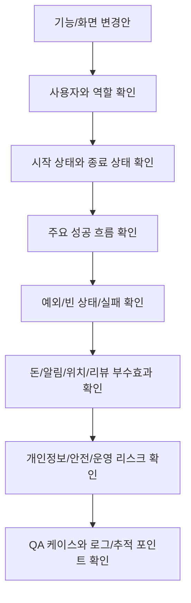
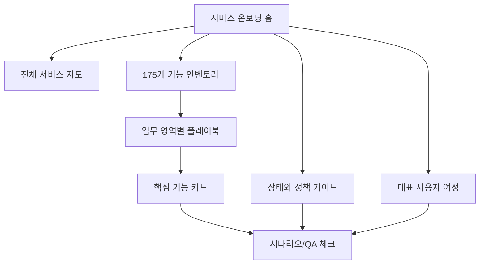
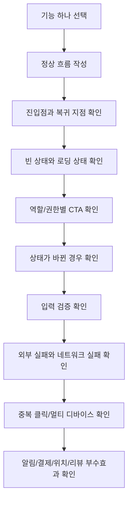

# 기획 QA 정책

<!-- release-document: reference -->
> **문서 구분: 기능·설계·절차 참고 문서.** 본문의 요구사항·과거 확인은 현재 미구현 목록이 아닙니다. 현재 작업 순서는 [앞으로 할 일](../../../docs/plan/NEXT_WORK.md)을 따릅니다.


<!-- supporting-doc-status: 2026-11-22 -->

> 문서 상태: **보조 문서**. 기능별 현재 계약, source trace, Gap/Risk 판단은 [기능 PRD 전환 현황](../PRD_MIGRATION_STATUS.md)와 각 기능 PRD를 우선한다. 이 문서는 인벤토리, 정책, QA, 기획 운영 기준을 보조하며, 기능 세부 판단은 [기능 PRD 작성·검수 기준](../FEATURE_PRD_STANDARD.md) 기준으로 재확인한다.

이 문서는 새 화면, 새 정책, 기존 기능 변경을 검토할 때 사용하는 마지막 점검표다. 기능이 많을수록 "주 흐름"은 기억하지만 상태, 돈, 알림, 권한, 개인정보, 외부 실패를 놓치기 쉽다.

## 검증할 질문과 증거 선택

변경한 내용과 아직 해결되지 않은 의문을 먼저 적고, 그 질문을 판정할 수 있는 증거를 고른다. 적용하지 않는 범주는 이유를 적고 제외한다. 모든 기능에 같은 수의 새 시험·이미지·기기 조합을 만들지 않는다. 문서만 고친 경우에는 내용 대조·링크·파생 문서 동기화를 검사하며 제품 실행을 했다고 기록하지 않는다.

| 판정할 질문 | 사용할 증거 | 그 증거만으로 말할 수 없는 것 |
|---|---|---|
| 요청 값·역할·상태·중복·복귀 | 해당 소스와 실제 조건을 단언하는 시험·로그 | 파일 존재만으로 시험 통과, 로컬 통과만으로 운영 통과 |
| 버튼 위치·잘림·대비·이미지 표시 | 문제가 있는 대표 화면의 실제 이미지 | 화면 한 장으로 요청 성공·정산 완료·알림 도착 |
| 실제 메뉴 입구·업무 결과·복귀 | 해당 버전의 앱에서 구체적인 경로를 실행한 결과 | 탐색 맵·문서 HTML·목업으로 실제 앱 동작 |
| 메일·푸시·PG·은행·서명 앱 | 대상 환경에서 해당 외부 결과를 확인한 기록 | 발송 의도·큐 등록·요청 접수만으로 수신·지급 완료 |
| 문서 통계·연결 | 현재 입력 파일과 집계 규칙·링크 검사 | 시나리오 등록 수·소스 주소 존재로 전체 내용·실행 검증 |

UI 확인이 필요한 변경은 기본 390×844·글자 1배의 실제 입구 → 정상 업무 → 결과 → 원래 상태 복귀를 따른다. 큰 글자·작은 폭 조합은 기본 범위에 넣지 않고 해당 환경의 보고된 결함 또는 사용자 요청에 따라 선택한다. 이미지 없이 판정할 수 있는 상태·권한·키·횟수는 시험과 로그로 확인한다. 테마·분기별 전수 캡처를 기본 절차로 만들지 않는다.

버전과 확인 범위가 맞는 기존 근거는 재사용한다. 변경·새 실패·미해결 의문이 없으면 같은 소스·로그·이미지·회귀 실행을 반복하지 않는다. 근거가 바뀌었을 때 해당 판단만 다시 확인한다. [기능 PRD 작성·검수 기준](../FEATURE_PRD_STANDARD.md#수용-기준과-검증-근거)과 저장소의 검수 운영 규칙을 함께 적용한다.

## 실제 접근 경로와 중복 행동 확인

화면 주소만 직접 열어 확인을 끝내지 않는다. 해당 기능으로 이어지는 실제 메뉴·카드·목록·알림·공유 링크와 로그인 후 복귀 경로를 적는다. 같은 행동이 햄버거 메뉴·상단 독립 버튼·더보기 메뉴·하단에 동시에 나타나는지 비교하고, 상태·역할 때문에 입구가 달라지는 경우에는 그 조건을 명시한다.

입구마다 먼저 확인할 것은 접근 가능 여부·실행 대상·변경 결과·돌아왔을 때 갱신되는 상태다. 공통 동작은 검증한 근거를 재사용하고 차이가 있는 입구만 추가 확인한다. 업무에 필요한 서로 다른 입구와 불필요한 중복 행동은 승인된 제품 기준으로 구분한다. 이 검토표가 기존 입구를 임의로 제거할 권한을 새로 만들지는 않는다.

## 전체 점검 흐름



## 1. 사용자와 역할

| 체크 | 질문 |
|---|---|
| 주 사용자 | 이 기능을 가장 자주 쓰는 사람은 누구인가 |
| 보조 사용자 | 같은 기능의 결과를 받는 사람은 누구인가 |
| 금지 사용자 | 버튼을 보거나 실행하면 안 되는 사람은 누구인가 |
| 복합 역할 | 호스트이면서 참가자, 클럽 관리자이면서 일반 멤버 같은 경우가 있는가 |
| 비정상 계정 | 제재·탈퇴 예약·탈퇴 상태와 가입 전 번호 확인은 각각 어떻게 되는가 |

## 2. 시작 상태와 종료 상태

| 체크 | 질문 |
|---|---|
| 시작 상태 | 사용자가 이 화면에 들어오기 전에 반드시 만족해야 하는 조건은 무엇인가 |
| 성공 종료 | 성공 후 어떤 상태/화면/데이터가 바뀌는가 |
| 실패 종료 | 실패 후 사용자가 다시 시도할 수 있는가 |
| 중간 이탈 | 입력 중 뒤로가기, 앱 종료, 네트워크 끊김 후 재진입은 어떻게 되는가 |
| 상태 갱신 | 다른 기기나 다른 사용자의 액션으로 상태가 바뀌면 어떻게 반영하는가 |

## 3. 빈 상태와 에러 상태

| 화면 상태 | 반드시 정해야 할 것 |
|---|---|
| 최초 로딩 | 스켈레톤, 스피너, 빈 화면 중 무엇을 쓰는가 |
| 데이터 없음 | 사용자가 다음에 할 수 있는 액션이 있는가 |
| 일부 실패 | 다른 섹션은 보여줄 수 있는가 |
| 전체 실패 | 재시도 버튼이 있는가 |
| 권한 없음 | 로그인 유도, 접근 불가, 이전 화면 복귀 중 무엇인가 |
| 만료/삭제 | 대상이 사라졌거나 만료되었을 때 문구는 무엇인가 |

## 4. 돈이 움직이는 기능

| 체크 | 질문 |
|---|---|
| 잔액 부족 | 충전으로 보낼 것인가, 자동충전을 시도할 것인가 |
| 결제수단 없음 | 결제수단 등록 화면으로 보낼 것인가 |
| 결제 성공 | 거래내역, 잔액, 원래 기능 상태가 모두 갱신되는가 |
| 결제 실패 | 사용자에게 PG 실패인지 잔액 부족인지 구분해서 보이는가 |
| 환불 | 환불 조건, 환불 시점, 환불 금액, 원거래 연결이 명확한가 |
| 중복 결제 | 같은 버튼을 여러 번 누르거나 콜백이 중복 도착해도 안전한가 |
| 정산 | 호스트 돈과 참가자 돈, 클럽 기금이 섞이지 않는가 |

## 5. 알림이 나가는 기능

| 체크 | 질문 |
|---|---|
| 수신자 | 누가 받아야 하는가 |
| 제외자 | 본인에게도 보내는가, 보내지 않는가 |
| 트리거 | 어떤 상태 전이에 알림이 나가는가 |
| 문구 | 사용자가 다음 행동을 바로 이해할 수 있는가 |
| 설정 반영 | 카테고리 꺼짐이나 방해금지 시간에 걸리면 어떻게 되는가 |
| 딥링크 | 알림을 눌렀을 때 어디로 가는가 |
| 실패 | 푸시 실패해도 앱 내 알림함에는 남는가 |

## 6. 위치와 개인정보

| 체크 | 질문 |
|---|---|
| 명시적 동의 | 위치, 프로필, 데이터 내보내기, 삭제는 사용자가 명확히 동의했는가 |
| 중지 동선 | 위치 공유, 알림, 노출, 구독을 끄는 경로가 있는가 |
| 보관 기간 | 위치나 데이터 추출 파일은 언제까지 보관되는가 |
| 노출 범위 | 타인에게 보이는 정보와 본인에게만 보이는 정보가 구분되는가 |
| 민감 상태 | 차단, 신고, 신뢰점수, 데이팅 인증 상태가 과도하게 노출되지 않는가 |

## 7. 리뷰, 신고, 신뢰점수

| 체크 | 질문 |
|---|---|
| 작성 자격 | 실제 참석자, 구매자, 매칭 사용자 등 자격을 확인했는가 |
| 중복 방지 | 같은 대상에 여러 번 리뷰/신고할 수 있는가 |
| 수정/삭제 | 작성자가 바꿀 수 있는 범위와 횟수는 무엇인가 |
| 운영 접수 | 신고 후 사용자가 결과를 어떻게 인지하는가 |
| 신뢰 영향 | 리뷰, 노쇼, 신고, 차단이 점수에 반영되는가 |
| 공개/비공개 | 공개 리뷰와 비공개 취향 평가를 구분했는가 |

## 8. 외부 시스템 의존

| 외부 시스템 | 실패 시 확인할 것 |
|---|---|
| 소셜 로그인 앱 연동 모듈 | 사용자가 취소, 토큰 검증 실패, 연동 제공자 오류 |
| 이메일 발송 | 발송 실패, 번호·확인표 만료, 재발송 제한 |
| PG/결제 | 결제 중 이탈, 콜백 지연, 중복 콜백, 승인 실패 |
| 푸시 알림 | OS 권한 거부, 토큰 만료, 다중 기기 |
| 지도/지오코딩 | 권한 거부, 시스템 연동 장애, 주소 없음, 외부 지도 앱 미설치 |
| 파일 업로드 | 업로드용 임시 주소 실패, 업로드 실패, 삭제 실패 |

## 9. 중복, 동시성, 멀티 디바이스

| 상황 | 예시 | 검토 포인트 |
|---|---|---|
| 중복 클릭 | 신청 버튼 연타, 결제 버튼 연타 | 버튼 잠금, 멱등 처리, 실패 복구 |
| 동시 상태 변경 | 정원 마지막 자리, 대기열 승격 | 최신 상태 재조회, 안내 문구 |
| 멀티 디바이스 | 한 기기에서 로그아웃, 다른 기기에서 호출 | 토큰/세션 상태 동기화 |
| 관리자와 사용자 동시 액션 | 호스트가 취소하는 중 참가자가 결제 | 우선순위, 환불, 알림 |
| 외부 콜백 지연 | PG 성공 후 앱 복귀 전 서버 처리 지연 | pending 화면, 재조회 |

## 10. 기능별 레드 플래그

| 영역 | 레드 플래그 |
|---|---|
| 인증 | 가입 전 번호·확인표 검증, 가입 성공 뒤 세션 설치 실패, 마지막 로그인 수단 제거, 토큰 갱신 반복 |
| 홈/검색 | 비로그인과 로그인 결과 차이, 부분 실패, 캐시로 오래된 CTA 노출 |
| 이벤트 | 정원/대기열/승인/결제가 한 버튼에 섞이는 경우 |
| 클럽 | 관리자와 소유자 권한 혼동, 차단 시 환불/멤버십 정리 누락 |
| 결제 | 결제 성공과 기능 성공이 분리되는 경우 |
| 정산 | 작성중 상태인데 참가자에게 납부 요청이 보이는 경우 |
| 플랜 | 작성물, 판매상품, 구매 보유물이 섞이는 경우 |
| 데이팅 | 차단 후 채팅/매칭이 남아 있는 경우 |
| 캘린더 | 반복 일정 일부만 삭제하는 UI가 있는데 서버 정책이 단일 삭제인 경우 |
| 리뷰 | 미참석자 리뷰, 자기 신고, 중복 신고 |
| 알림 | 푸시 권한이 없는데 앱 내 알림도 없는 것처럼 보이는 경우 |
| 프로필 | 삭제 예약과 즉시 비활성화 문구 혼동 |
| 위치 | opt-in 없이 위치가 보이거나, opt-out 후 마커가 남는 경우 |

## 11. PRD 작성 전 최종 질문

```text
1. 이 기능은 현재 21개 업무 영역 중 어디에 속하는가?
2. 175개 기능 인벤토리 중 기존 기능의 확장인가, 신규 기능인가?
3. 주 사용자와 금지 사용자는 누구인가?
4. 시작 상태와 성공 종료 상태는 무엇인가?
5. 실패했을 때 사용자는 다음에 무엇을 할 수 있는가?
6. 돈, 알림, 위치, 캘린더, 리뷰/신뢰 중 움직이는 것이 있는가?
7. 빈 상태와 권한 없음 상태를 정의했는가?
8. 외부 시스템 실패를 정의했는가?
9. 중복 클릭과 멀티 디바이스를 정의했는가?
10. 관련 위험에 대해 시작 조건·조작·관찰 결과와 필요한 근거를 적었는가?
```

## 12. Notion 운영 권장 구조



175개 기능 PRD를 현재 제품 내용의 정본으로 사용한다. Notion 카드는 정본을 연결한 목적별 요약이며 독립적인 구현 상태나 미완료 총계를 만들지 않는다. 카드가 없다는 이유로 해당 기능 PRD도 없다고 판단하지 않는다.

## 시나리오 커버리지 기준

2026-11-22 집계의 대상은 175개 기능·21개 업무 영역이다. 기능 목록의 시나리오 등록 수 합계는 1,654개이고, 상세 시나리오 문서 117개에서 식별한 제목은 1,276개다. 두 값은 집계 대상이 다르다. 상세 문서가 없는 58개 기능도 기능 PRD의 수용 기준을 가질 수 있으며, 제목 집계에서 0이라고 시험·정의가 없다는 뜻은 아니다.

[시나리오 집계 자료](../../docs/assets/scenario-audit.js)는 상세 문서의 지정된 제목 패턴만 세고, [기능 목록 자료](../../docs/assets/features.js)는 기능별 등록 수를 제공한다. 시험 파일 참조·기능 번호 발견·기존 출시 근거 표시는 각각 별도 값이다. 어느 수도 이번 최신화에서 새로 통과한 시험 수나 전체 시나리오 통과율이 아니다. 자동 집계의 근거 연결 단계 역시 모든 수용 기준을 검증했다는 판정으로 확대하지 않는다.

## 커버리지 원칙

다음 8개 범주의 관련성을 검토한다. 해당 기능·변경에 필요한 조건을 골라 시작 상태·조작·관찰 결과를 적고, 적용하지 않는 조건은 이유를 남긴다. 범주 수를 필수 시험 실행 횟수로 바꾸지 않는다.

| 범주 | 질문 | 예시 |
|---|---|---|
| 정상 흐름 | 사용자가 기대한 대로 성공하는가 | 회원가입 완료, 이벤트 신청 성공, 정산 납부 완료 |
| 진입/복귀 | 어디서 들어오고 어디로 돌아가는가 | 홈 카드, 알림 딥링크, 백버튼 복귀 |
| 빈 상태 | 데이터가 없을 때 자연스러운가 | 리뷰 없음, 검색 결과 없음, 등록 기기 없음 |
| 권한/역할 | 이 사용자가 이 액션을 할 수 있는가 | 비호스트 정산 생성 차단, 타인 리뷰 수정 차단 |
| 상태 불일치 | 화면을 보는 사이 상태가 바뀌면? | 정원 마감, 이미 취소된 이벤트, 만료된 토큰 |
| 입력 검증 | 값이 부족하거나 잘못되면? | 비밀번호 약함, 금액 범위 초과, 시간 역전 |
| 실패/복구 | 네트워크나 외부 시스템이 실패하면? | PG 실패, SMTP 실패, 지도 시스템 연동 장애 |
| 중복/동시성 | 같은 액션을 반복하거나 여러 기기에서 하면? | 중복 신청, 토큰 동시 갱신, 일괄 승인 충돌 |

## 시나리오 검산 흐름



## 단위별 시나리오 수

같은 시점의 자료를 아래처럼 구분해 센다. 상세 제목 수가 기능 등록 수와 다르다고 그 차이를 미통과 시험으로 계산하지 않는다.

| 업무 영역 | 기능 수 | 목록 등록 수 | 상세 제목 수 | 상세 문서가 있는 기능 수 |
|---|---:|---:|---:|---:|
| 인증 & 온보딩 | 8 | 70 | 70 | 8 |
| 홈 피드 | 5 | 48 | 48 | 5 |
| 이벤트 | 20 | 172 | 172 | 12 |
| 클럽 | 18 | 260 | 250 | 16 |
| 검색 | 5 | 50 | 50 | 5 |
| 결제 & 지갑 | 10 | 106 | 106 | 10 |
| 모임 정산 | 10 | 146 | 146 | 10 |
| 플랜 마켓 | 15 | 172 | 150 | 13 |
| 프라이빗 데이팅 | 8 | 51 | 51 | 8 |
| 캘린더 | 5 | 38 | 38 | 5 |
| 리뷰 & 신고 | 7 | 54 | 47 | 6 |
| 알림 | 6 | 38 | 39 | 6 |
| 프로필 & 설정 | 7 | 72 | 72 | 7 |
| 위치 & 길찾기 | 6 | 37 | 37 | 6 |
| 경고 & 징계 | 9 | 57 | 0 | 0 |
| 마일리지 | 8 | 69 | 0 | 0 |
| 정기모임 | 10 | 83 | 0 | 0 |
| 분쟁 해결 | 5 | 41 | 0 | 0 |
| 관심인 | 3 | 0 | 0 | 0 |
| 고객지원 | 3 | 21 | 0 | 0 |
| 제공자 배정·정산 | 7 | 69 | 0 | 0 |

## 영역별 검토 우선순위

아래는 검토 질문의 우선순위이며 모든 기능의 고정 시험 목록이 아니다. 기능 정본의 현재 조건과 변경 범위에서 실제 대상을 고른다.

| 영역 | 우선 확인할 경계 |
|---|---|
| 인증·프로필 | 가입 전 확인과 계정 생성·세션 설치, 제한 계정, 이전 계정의 늦은 응답 |
| 이벤트·클럽·정기모임 | 실제 입구, 현재 역할, 심사·결제 대기·참석, 대상 회차, 취소·소유권 책임 |
| 지갑·정산·마켓·제공자 | 유료·무료 금액, 수단별 공개 조건, 동일 요청 재조회, 결과 불명, 반환·미수금·후속 복구 |
| 데이팅·위치·관심인 | 명시적 동의와 공개 범위, 양방향 차단, 중지·해제 차이, 좌표·자료의 보존과 파기 |
| 알림·고객지원·신고·분쟁 | 대상자와 처리자, 접수·판단·통지 의도·실제 수신, 사건 접근·증거 가시성·보존 |
| 검색·홈·캘린더·리뷰·마일리지 | 조회 문맥·부분 실패, 빈 결과, 현재 권한, 집계 갱신, 결과와 원본 기록의 차이 |

금전 조건은 [결제·정산 정책](payment_settlement_policy_prd.md), 민감 자료는 [개인정보·안전 정책](privacy_safety_policy_prd.md), 통지 결과는 [알림 정책](notification_policy_prd.md)을 함께 확인한다.

## 핵심 여정별 빠뜨리기 쉬운 시나리오

### 가입/인증

| 시나리오 | 왜 중요한가 |
|---|---|
| 가입 전 번호 확인과 가입 뒤 내 정보 조회 실패 | 번호 확인·계정 생성·앱 세션 설치가 다른 단계임 |
| 인증번호 재발송 제한·확인표 만료 | 번호 발송·번호 확인·가입 제출의 유효성을 각각 안내해야 함 |
| 소셜 가입 후 추가정보 미입력 이탈 | 가입은 됐지만 추천 불가능 상태가 될 수 있음 |
| 토큰 만료 중 여러 요청 동시 발생 | 사용자가 갑자기 로그아웃되는 것처럼 보일 수 있음 |
| 마지막 로그인 수단 해제 시도 | 계정 잠김을 막아야 함 |

### 이벤트/클럽 참여

| 시나리오 | 왜 중요한가 |
|---|---|
| 정원이 찬 직후 신청 | 리스트에서는 가능해 보였지만 상세에서는 실패할 수 있음 |
| 대기열 자동 승격 | 사용자 행동 없이 상태가 바뀌므로 알림과 CTA 갱신이 필요 |
| 호스트가 자기 이벤트에 신청 | 권한상 막아야 하며 메시지가 명확해야 함 |
| 이벤트 취소 후 유료 참가자 환불 | 돈과 알림이 동시에 움직임 |
| 유료 승인제 이벤트의 승인 후 결제 | 승인, 정원 예약, 결제, 참석 확정이 분리됨 |
| 클럽 멤버 추방/차단 | 게시글, 이벤트, 구독, 환불까지 영향 가능 |

### 결제/정산

| 시나리오 | 왜 중요한가 |
|---|---|
| 결제수단 등록 후 PG 콜백 실패 | 사용자는 완료했다고 생각할 수 있음 |
| 자동충전 실패 후 원래 결제 실패 | 실패 원인을 두 단계로 설명해야 함 |
| 승인제 유료 이벤트에서 미승인 사용자가 결제 시도 | 돈을 먼저 받으면 거절/환불 리스크가 생김 |
| 정산 요청 전 항목·분담·종료 시각 확인 | 검토만 가능한 상태와 실제 납부 요청 가능 상태를 구분해야 함 |
| 계좌이체 후 호스트 미확인 | 참가자는 냈다고 생각하지만 시스템은 미완료일 수 있음 |
| 이의제기 수락/기각 | 금액, 상태, 알림, 감사로그가 함께 바뀜 |

### 데이팅/위치/안전

| 시나리오 | 왜 중요한가 |
|---|---|
| 미인증 사용자의 데이팅 진입 | 안전 신뢰의 출발점 |
| 상호 좋아요 직후 한쪽이 차단 | 매칭/채팅 상태 cascade가 필요 |
| 만남 제안 후 일정/장소 변경 | 캘린더와 위치 안내에 영향 |
| 위치 권한 영구 거부 | 앱 안 CTA만으로 해결되지 않고 OS 설정이 필요 |
| 위치 공유 자동 만료 | 사용자가 계속 보인다고 오해하지 않게 해야 함 |

### 리뷰/신고/신뢰

| 시나리오 | 왜 중요한가 |
|---|---|
| 미참석자의 리뷰 작성 | 평판 조작을 막아야 함 |
| 중복 리뷰/중복 신고 | 운영 큐와 점수 왜곡 방지 |
| 본인 신고 | 악용과 오류를 막아야 함 |
| 리뷰 수정/삭제 후 신뢰점수 | 점수가 언제 재계산되는지 명확해야 함 |
| 데이터 부족한 취향 프로필 | 빈 차트보다 설명 있는 빈 상태가 필요 |

## 기능 카드 작성 전 체크

```text
기능 ID:
기능명:

[ ] 정상 성공 흐름이 있다.
[ ] 사용자가 들어오는 진입점이 2개 이상이면 모두 적었다.
[ ] 빈 상태, 로딩, 전체 실패, 부분 실패를 구분했다.
[ ] 비로그인/로그인/소유자/관리자/대상자 권한이 구분됐다.
[ ] 상태가 화면 진입 후 바뀌는 경우를 적었다.
[ ] 입력값 범위와 필수값을 적었다.
[ ] 외부 시스템을 사용하는 경우 실패·결과 불명·결과 조회를 적었다.
[ ] 중복 클릭·재시도·다른 기기와의 상태 변경 중 관련 조건을 적었다.
[ ] 돈, 알림, 캘린더, 위치, 리뷰/신뢰 영향이 있는지 확인했다.
```

## 완료 근거 기록

결과에는 기능·입구·역할·시작 상태, 확인한 저장소 버전과 변경 범위, 관찰 결과, 사용한 근거의 위치·확인 범위, 남은 제한을 함께 적는다. 기존 시험을 읽은 경우와 새로 실행해 통과한 경우를 구분한다. 문서·소스 대조 완료를 배포·공개·실사용 확인으로 바꾸지 않는다.

실행 중인 작업은 확인한 프로세스·세션을 이어 확인한다. 단순 응답 대기나 출력 관찰 시간 만료만으로 같은 작업을 다시 시작하지 않는다. 필요한 검사가 통과하면 추가 검증은 새 변경·실패·의문이 있을 때만 수행한다. 현재 작업과 남은 결정은 정본 작업 목록으로 연결한다.
